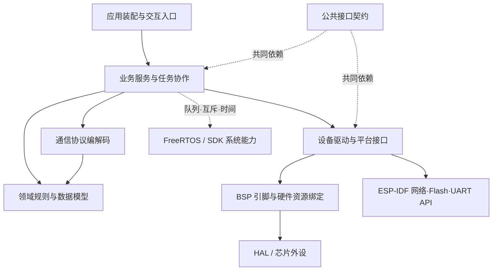
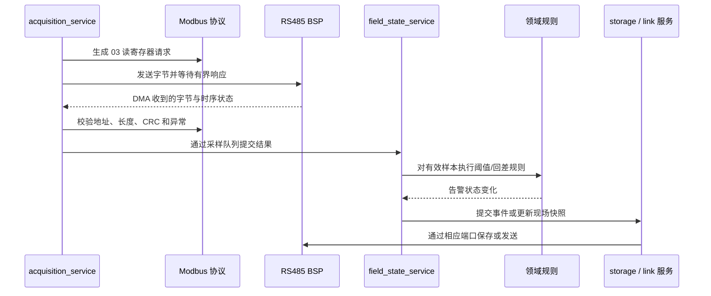

# 智能育苗室：架构分层与代码导航

本项目采用 **双 MCU 职责分离 + 分层模块化 + FreeRTOS 任务协作**。

STM32F407 是现场控制器，负责采集、数据质量、告警与本地持久化；ESP32-S3 是网络网关，负责配网、HTTP/MQTT、待发记录与自身 OTA。两板通过 UART V2 交换业务消息，CAN2 用于 F407 的电脑诊断链路。

## 1. 先记住每层回答什么问题

| 层次 | 回答的问题 | 当前代码例子 |
| --- | --- | --- |
| 应用层 Application | 这个产品启用哪些功能，怎样组装与启动？ | `nursery_app.c`、F407 `gateway_app.c`、网页/串口/按键入口 |
| 服务层 Services | 功能如何按周期或事件运行，状态和资源由谁管理？ | 采集调度、现场状态、命令处理、日志、MQTT 补传、OTA 事务 |
| 协议层 Protocol | 一段字节表示什么，怎样编码、校验和还原？ | UART V2、Modbus RTU、CAN 诊断映射、升级清单 JSON |
| 设备驱动/平台适配层 Drivers | 如何操作外设或调用底层能力？ | W25Q 指令、ESP32 UART、NVS 配置、HTTP 下载与 OTA 分区适配 |
| 板级支持层 BSP | 具体接哪个引脚、用哪个控制器，怎样配置寄存器？ | SPI1/PG6、USART2/PC0、USART3、CAN2、TIM7、IWDG |
| 领域内核 Domain（共享） | 什么条件构成有效配置和超限告警？ | 九测点配置、量程、三样本确认和恢复回差 |
| 公共接口契约 Contracts（共享） | 不同实现共同遵守哪些数据与函数接口？ | OTA 字节流、镜像、摘要和平台操作接口 |

领域内核和公共契约是服务、协议、适配器共同使用的基础模块，不是必须逐级经过的流水线。FreeRTOS、STM32 HAL、ESP-IDF 是基础运行环境；RTOS 任务划分不等于架构分层。



这是源码依赖和职责图。数据从传感器上行时，处理顺序会从底层向上；调用函数时，服务通常调用协议函数和端口接口。

## 2. STM32F407 的实际目录

```text
fireware/stm32f407/
├── Application/                    应用层
│   ├── Inc/gateway_app.h           CubeMX 可见的应用入口
│   └── Src/gateway_app.c           薄装配门面，调用服务初始化/运行入口
├── Services/                       业务服务层
│   ├── Inc/field_services.h        对应用公开的服务接口
│   ├── Private/field_internal.h    仅服务层可见的 IPC、快照和内部协作接口
│   └── Src/
│       ├── field_state_service.c   配置、测点质量、告警、回执与待补记
│       ├── acquisition_service.c   六从站轮询、超时/重试、离线探测和恢复
│       ├── field_link_service.c    会话校验、命令路由、快照上报
│       ├── storage_service.c       A/B 配置、循环日志、启动恢复与事件追补
│       └── supervisor_service.c    任务健康期限、统一喂狗决策与诊断
├── Protocol/                       协议层，纯 C
│   ├── Inc/                        协议公开头文件
│   └── Src/
│       ├── modbus_rtu.c            03 请求、响应、CRC、异常帧校验
│       └── can_diag_protocol.c     业务消息与 8 字节 CAN 载荷的映射
├── Drivers/
│   ├── Device/Inc, Src/            自己编写的设备驱动：w25q_flash
│   ├── STM32F4xx_HAL_Driver/       ST 的 HAL 外设驱动
│   └── CMSIS/                      ST/ARM 芯片基础支持
├── Bsp/                            板级支持层，Inc/Src 分开
│   └── Src/
│       ├── board_flash_port.c      SPI1 与 PG6 片选的实际收发
│       ├── rs485_port.c            USART2 DMA、PC0 方向、发送完成切向
│       ├── rs485_timing.c          TIM7/DWT 的 RTU 间隔检测
│       ├── field_link_port.c       USART3 DMA、CAN2 邮箱/IRQ/恢复
│       └── board_system.c          时钟、诊断串口、延时与 IWDG 硬件动作
├── Config/modbus_profile.h         产品仪表地址/寄存器/倍率/超时参数
├── Core/Inc, Src/                  CubeMX 生成的启动、外设配置和任务入口
├── Middlewares/                    FreeRTOS 等第三方实现
└── cmake/nursery_layers.cmake      手写各层的独立构建目标与依赖关系
```

`Core` 是生成代码与硬件启动入口，不是所有业务都放进去的“核心业务层”。`Config` 是静态产品参数，不包含任务或业务执行逻辑。

### 具体边界

- `Application` 不处理 Modbus、告警细节或 Flash 操作，只提供 CubeMX 调用入口。
- `Services` 可以使用 FreeRTOS、领域函数、协议函数和下层接口；不直接包含 `main.h/usart.h/spi.h/can.h`，不调用 HAL 或访问硬件寄存器。
- `Protocol` 不知道任务、GPIO、DMA 和队列。CAN 载荷编码不会调用 CAN 邮箱。
- `w25q_flash.c` 负责 JEDEC、读写指令、跨页拆分和 BUSY 等待；不知道配置 A/B 和事件日志地址。
- `storage_service.c` 决定写哪条配置/事件，`w25q_flash.c` 决定如何对芯片发指令，`board_flash_port.c` 决定具体用 SPI1 和 PG6。
- `supervisor_service.c` 决定是否满足喂狗条件，`board_system.c` 执行 IWDG 寄存器配置和刷新。

## 3. ESP32-S3 的实际目录

```text
main/
├── main.c                          ESP-IDF app_main，转入应用装配
└── Kconfig.projbuild               产品选项、引脚、Broker 与 OTA 参数
components/
├── application/
│   ├── nursery_app/                应用装配、依赖注入、启动与回调适配
│   ├── gateway_http/               网页/API 入口与命令查询
│   ├── ota_button_service/         按键升级入口
│   └── ota_console_service/        串口维护入口
├── services/
│   ├── gateway_link/               帧接收、现场投影、会话、串行命令与回执
│   ├── gateway_outbox/             待发记录生命周期、持久队列与追补位置
│   ├── app_config_service/         网关上报周期配置业务
│   ├── wifi_manager/               配网、凭据策略、重连和 AP 回退
│   ├── mqtt_service/               上报/补传调度、消息确认与云端命令入口
│   ├── firmware_update_service/    OTA 事务编排
│   └── boot_health_service/        新镜像首启健康确认
├── protocol/
│   ├── gateway_protocol/           共享 UART 编解码的 IDF 组件封装
│   └── update_manifest_json/       Manifest JSON 与标准清单结构转换
├── domain/
│   └── nursery_domain/             共享纯 C 领域模型的 IDF 组件封装
├── contracts/
│   └── update_contracts/           OTA 公共接口，只有契约头文件
└── drivers/
    ├── uart_port/                  UART 字节收发，屏蔽 ESP-IDF 外设 API
    ├── config_store/               NVS 小型配置存取
    ├── update_transport_http/      HTTP 下载字节流适配
    ├── update_integrity_sha256/    SHA-256 平台适配
    └── update_platform_esp32/      OTA 分区、写入和激活适配
```

每个有实现的组件仍分 `include/` 与 `src/`，并有自己的 CMake 依赖。共享领域与协议组件的源码实际在 `shared`，避免复制两套实现。

ESP-IDF 已提供 Wi-Fi、MQTT、HTTP、NVS、UART 和系统服务。项目自己的 Wi-Fi/MQTT 服务负责连接策略和业务编排，没有自行实现射频驱动或 TCP/IP 栈。待发队列服务直接使用 SDK 的 NVS 后端，记录排序、容量和 ACK 策略属于服务职责。

### 两个真实的接口解耦例子

1. 应用层创建 `uart_port`，将字节端口句柄注入 `gateway_link`；`gateway_link` 不再配置 GPIO 或调用 `uart_driver_install()`。更换 UART 引脚或字节端口时，不需要修改帧解析和命令状态机。
2. OTA 服务和 HTTP/SHA/Flash/JSON 适配器共同依赖 `update_contracts`。应用装配时注入函数接口；底层适配器不再反向包含升级服务头文件或链接服务实现。

## 4. 两板共享的纯 C 内核

```text
shared/
├── domain/
│   ├── include/nursery_model.h
│   └── src/nursery_model.c
└── protocol/
    ├── include/gateway_protocol.h
    └── src/gateway_protocol.c
```

领域层决定“什么算超限、怎样恢复、配置是否合法”；服务层决定“什么时候采集、把规则应用到哪个测点、何时保存和上报”。领域层不创建任务、不写 Flash，也不调用两种芯片的 SDK。

## 5. 用一条采集链解释各层怎样合作



Flash 的最后一步通过 W25Q 设备驱动和 SPI BSP 完成；上报通过 UART/CAN 协议编解码与链路 BSP 完成。不同业务不必机械经过每个目录。

## 6. 分层和任务是两个维度

| 任务 | 运行的服务 | 使用的下层模块 |
| --- | --- | --- |
| ModbusTask | acquisition_service | Modbus 编解码、RS485 端口与时序 |
| FieldTask | field_state_service | 领域规则、命令/样本队列和存储接口 |
| LinkTask | field_link_service | UART/CAN 编解码、字节端口 |
| StorageTask | storage_service | W25Q 驱动、SPI BSP |
| SupervisorTask | supervisor_service | 健康期限与系统 BSP |

一个服务可以调用多个协议和驱动；一个协议库也可以被多个任务使用。不能将“有五个任务”当成“采用五层架构”。共享现场状态由 FieldTask 统一修改；队列传递请求和结果，互斥量保护短时间快照复制。

## 7. 面试可以这样讲

> 我的项目先按双 MCU 划分职责：F407 保证现场采集、告警和记录独立运行，ESP32 负责网络与远程维护。单板内部采用分层模块化设计：应用层负责装配启动；服务层管理采集、命令、存储和升级流程；协议层负责 Modbus、UART 和 CAN 的编解码；驱动层负责器件操作；BSP 绑定具体引脚与外设。告警规则是共享的纯 C 领域模块，不依赖芯片。运行时用 FreeRTOS 的队列、互斥量和任务通知协调，各任务有明确的数据所有权。例如改 Flash 型号主要影响驱动和 BSP，告警规则不需要跟着改。

追问时用真实文件展开：

- **为什么服务和驱动分开？** `storage_service` 关心配置和事件；`w25q_flash` 关心页写和擦除；`board_flash_port` 关心 SPI1/PG6。
- **协议和串口有什么区别？** `gateway_protocol` 把帧转成字节，`uart_port/field_link_port` 收发字节；RS485 电气收发与 Modbus 规则也分开。
- **怎么防止分层变成空目录？** F407 的领域、协议、BSP、设备驱动、服务和应用分别是构建目标，私有服务头只对服务目标开放；ESP-IDF 各组件显式声明依赖。本轮也检查了上层没有遗留直接 HAL/寄存器操作。
- **改哪里最合适？** 改阈值规则看 Domain；改轮询与重试策略看 Services；改帧格式看 Protocol；改 Flash 指令看 Drivers；换引脚看 BSP/Core/Kconfig。

## 8. 后续修改规则

文件内部的命名、注释和排版遵守[代码书写规范](CODE_STYLE.md)。

1. 新业务先判断是规则、流程、编解码还是硬件动作，再选择目录。
2. 领域和纯通信协议不包含 HAL、ESP-IDF、FreeRTOS 头文件。
3. 服务内部状态放 Private，不让应用或驱动直接访问 `g_field` 和队列实现。
4. BSP 不引用业务服务，不决定告警阈值、离线策略或 MQTT 主题。
5. 新硬件适配通过端口接口接入；SDK 已有的能力可以复用，无需每个函数都再包装一层。
6. CubeMX 的 USER CODE 仍调用 `GatewayApp_*` 门面；重新生成后复核应用门面、`cmake/nursery_layers.cmake` 和 DMA/IRQ 设置。

本次调整不改变 UART V2、CAN 诊断载荷、仪表映射或 Flash 分区定义。构建与检查结论见当前工程联调说明，实机验收仍需执行。
