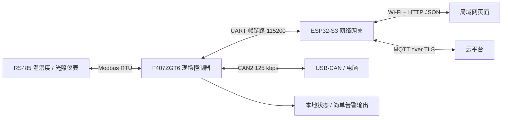

# 工业现场环境监测物联网边缘网关：项目方案

> 项目载体：STM32F407ZGT6 学习板 + ESP32-S3 N16R8 开发板  
> 项目定位：多协议采集、边缘汇聚、局域网监控与远程运维  
> 关系：独立于“精密实验环境运维系统”和 BMS 项目

后续开发先读 [工程索引](工程索引.md)，再按 [实施路线](代码实施路线.md) 进入需要的源码；F407 配置见 [霸天虎 V2 的 CubeMX 清单](CubeMX配置清单_霸天虎V2.md)。

**已确定的实机路线：**F407↔ESP32-S3 先走带版本、长度、序号和 CRC 的 UART 帧链路；F407 板载 CAN2↔USB-CAN/电脑单独验证 CAN 功能。ESP32-S3 有 TWAI 控制器，但现有板子没有 CAN 收发器；若将来增加 3.3 V 逻辑兼容的收发器，再评估两板 CAN 直连。

## 1. 一句话说明

面向车间、机房等普通工业环境监测场景，由 F407 通过 RS485/Modbus RTU 轮询温湿度、光照等仪表，并管理现场采集状态；由 ESP32-S3 通过 UART 帧链路接收数据，提供 Wi-Fi 配网、局域网页面、MQTT 云端上报和远程配置。F407 的 CAN2 通过 USB-CAN 与电脑联调。网络失效时现场采集继续运行，网关缓存有价值的数据，恢复后按确认结果补传。

项目的主线是 **现场设备接入 → 数据质量判断 → UART 跨板传输 → 本地/云端呈现 → 统一控制 → 故障恢复**；CAN2 作为独立现场总线与诊断能力。第一版不加入无关的音频、复杂规则引擎和整套工业 SCADA 功能。

## 2. 系统边界与职责



| 部分 | 拥有的状态与责任 | 故障时的行为 |
| --- | --- | --- |
| F407 | Modbus 轮询计划、实际采集启停状态、采样周期、设备在线状态、数据质量、简单本地告警 | ESP32 或外网断开后仍按最后有效配置采集；拒绝无效命令 |
| ESP32-S3 | Wi-Fi/配网、HTTP 状态与命令接口、MQTT/TLS、云端待发队列、ESP32 自身 OTA | UART 断开时标记 F407 离线；网络断开时缓存待发记录并保留本地网页 |
| 浏览器、云 | 仅发起操作并显示 F407 回报的实际状态 | 命令超时显示失败或待确认，不提前显示“已执行” |

F407 和 ESP32 是两块独立板卡。当前 UART 用 3.3 V TTL 电平交叉连接 TX/RX 并共地，传输层用长度、序号和 CRC 识别错误；它不需要两端 CAN 收发器。霸天虎 V2 底板已有 CAN2 收发器与 120 Ω 终端，可和现有 USB-CAN 模块组成两节点 CAN 台架。

## 3. 硬件与接口基线

| 硬件 | 建议资源 | 说明 |
| --- | --- | --- |
| STM32F407ZGT6 | CAN2；USART2；USART3；SPI1；IWDG | 底板 CAN2 `PB12/PB13`、RS485 `PA2/PA3`、板间 UART 候选 `PD8/PD9`、片外 SPI Flash `PB3/PB4/PB5/PG6` |
| 板载 RS485 收发器 | DE/RE 由 `PC0` 控制 | 跳帽将 USART2 接到 485 路径；A/B、终端与隔离按实际拓扑确认 |
| ESP32-S3 N16R8 | UART1、Wi-Fi、16 MB Flash、8 MB PSRAM | 板间 UART TX/RX 候选 GPIO17/GPIO18，需按开发板引脚图核对；TWAI 暂不参与板间通信 |

以上 F407 板载引脚来自霸天虎 V2 的原理图和配套例程。`USART3 PD8/PD9` 原本也通向未安装的 LCD/FSMC 接口，作为板间 UART 需在实物上确认可接线；ESP32 GPIO17/GPIO18 也待核对。F407 底板上的 CAN2 占用 `PB12/PB13`，片外 Flash 因此使用板载 SPI1。资料之间还有器件版本差异：硬件规格书写 W25Q64、TJA1042T/3、MAX485，而较新原理图写 W25Q128JV、SIT1042AQT/3、SIT3088EESA。最终以实物丝印和 JEDEC ID 为准。

## 4. 软件模块与任务

### F407

- `modbus_port`：USART2 + RS485 方向控制、接收帧边界和超时。
- `modbus_master`：多从机轮询、功能码 03、CRC16、异常码和设备级重试。
- `sample_store`：将原始寄存器值转换为工程量，附 `point_id`、单调时间、序号和 `VALID/STALE/FAULT` 质量状态。失败时不刷新旧值的时间戳。
- `field_state`：采集启停、采样周期及简单阈值告警的唯一写者；命令校验通过后才变更有效配置。
- `uart_link`：与 ESP32 交换带长度、序号和 CRC 的状态、测点、命令与执行结果。
- `can_diag`：CAN2 与 USB-CAN/电脑通信，做现场总线诊断、过滤器和 Bus-Off 恢复。
- `storage_service`：如采用板载 SPI Flash，先识别容量，再独占写入与分区边界；保存低频事件、配置和故障信息，不把每帧遥测无上限写入 Flash。
- `supervisor`：检查采集、通信与存储任务的进展后统一刷新 IWDG。

### ESP32-S3

- `uart_link`：接收传感器帧、发送命令、维护 F407 在线状态；未来若加 CAN 收发器再实现 TWAI 适配。
- `control_service`：汇总网页和 MQTT 入口，生成统一 `request_id`，维护 `PENDING/APPLIED/FAILED` 命令生命周期。
- `wifi_provisioning`：NVS 凭据、STA 重连、AP 配网和恢复入口。
- `web_service`：HTTP 提供页面和 JSON API；网页定时 `GET /api/status`，控制动作通过 `POST /api/commands` 提交。
- `mqtt_service`：TLS 连接、属性上报、命令订阅、重连与 QoS 1 确认。
- `offline_store`：专用数据分区的定长记录环；按记录 ID 追踪待发、在途与已确认状态。
- `ota_service`：ESP32 A/B 更新、首次启动自检、确认与回滚。F407 固件升级另设阶段，不混称为已由 ESP32 OTA 自动覆盖。

任务数量按阻塞行为与数据所有权决定，协议解析器和状态机本身不必各占一个任务。

## 5. 三条关键业务链

### 5.1 上行采集

```text
Modbus 仪表 → F407 CRC/超时/寄存器解析 → Sample + Quality
→ UART 数据帧 → ESP32 去重与状态缓存
→ HTTP 状态快照 / MQTT 待发队列
→ Broker 确认后释放对应待发记录
```

板间 UART 使用固定帧头、协议版本、消息类型、序号、载荷长度和 CRC16；测点载荷保存 `point_id、quality、scaled_value、sample_age_ms`。F407 保留原始采样时间，发送时计算样本年龄；ESP32 用接收时间减年龄形成采样时间估计，并在超过有效期时标记旧值。F407 的 CAN2 可另外把同一逻辑测点映射成经典 CAN 标准帧给电脑调试；CAN 硬件 ACK、UART 收到帧和 MQTT Broker 确认是不同层次。

### 5.2 网页与云端统一控制

```text
网页 / 云平台
→ ESP32 control_service 归一化命令、分配 request_id
→ UART 命令帧（版本、序号、操作码、参数）
→ F407 校验范围、去重、应用配置
→ UART 执行结果帧（序号、结果、实际状态）
→ ESP32 更新状态投影 → 网页下次 HTTP 轮询、MQTT 读取新状态
```

第一版命令只有采集启停、采样周期设置和状态查询。F407 是实际状态的权威来源；ESP32 的物模型只是镜像。UART 帧接收、F407 的“命令已执行”反馈、MQTT Broker 的 PUBACK 是三种不同确认，不能混用。命令超时可重试，但同一 `request_id/seq` 不能重复执行有副作用的操作。

### 5.3 配网与断网恢复

ESP32 上电后先读 NVS：有有效凭据则尝试 STA；无凭据或连接失败达到阈值则开放 AP 配网页面。成功取得 IP 后保存候选凭据，并关闭 AP，HTTP 服务继续监听 STA 地址。恢复配网可通过受控的本地维护入口实现；首轮不占用未确认的 F407 按键引脚。

Wi-Fi、IP、TCP/TLS、MQTT 分层记录健康状态，重连采用有上限的退避和抖动。网络离线不影响 F407 的采集；ESP32 对遥测执行有容量上限的环形缓存，恢复后按时间与优先级补传。关键事件优先于普通周期遥测；缓存满时明确记录丢弃计数。QoS 1 发布后，必须关联 `message_id` 与记录 ID，收到 `MQTT_EVENT_PUBLISHED` 后才推进删除指针；此事件表示 Broker 确认，不等于业务平台已经完成处理。

云平台演示可选用用户提供方案中的 OneNet 物模型，定义 `temperature`、`humidity`、`light`、`collect_enable`、`sample_period_ms`、`field_online` 六项属性。平台专属主题、鉴权 token 和 JSON 映射收敛到 `cloud_adapter`，不进入 F407 的板间协议；ESP32 必须按实际客户端配置确认 TLS 是否启用，不能只看主机名或端口号。网页和云端都显示同一个 F407 状态快照。

## 6. 关键场景的预期行为

| 场景 | 预期结果 | 核心观察量 |
| --- | --- | --- |
| 单个 Modbus 从机掉线 | 只将该设备点位标为 `STALE/FAULT`，其他从机继续轮询 | 各从机成功率、最后有效时间、CRC/超时计数 |
| 两板 UART 线断开 | ESP32 将 F407 标为离线；F407 保持现场采集；恢复后重新查询实际状态 | UART CRC/超时计数、心跳超时、状态切换 |
| F407 CAN2 Bus-Off | USB-CAN/电脑侧看不到新帧；F407 的 Modbus 采集和 UART 上报继续运行 | CAN 错误计数、Bus-Off 次数、恢复间隔 |
| 网页和云同时修改周期 | F407 串行处理，最终状态以其执行回执和状态查询为准 | `request_id`、UART 序号、执行结果、最终周期 |
| Wi-Fi/MQTT 中断后恢复 | 局域网与云状态分别降级；已入持久队列的记录分批补传 | 缓存深度、最老记录年龄、PUBACK、丢弃计数 |
| ESP32 更新后自检失败 | 启动到原先确认有效的分区 | `pending_verify`、确认状态、回滚原因 |

## 7. 可靠性与面试中要讲清的取舍

1. **为什么 F407 + ESP32，而不是 F407 + ESP8266 AT？** ESP32 直接承担 Wi-Fi、TLS、MQTT、Web 服务和 A/B OTA；F407 专注现场总线及本地状态。避免在 F407 上手工拼 MQTT 报文。
2. **为什么现阶段两板用 UART、CAN 连电脑？** ESP32-S3 有 TWAI 控制器但缺外部 CAN 收发器；UART 使用现有两板 3.3 V TTL 引脚即可联通，而 F407 板载 CAN2 与 USB-CAN 足以验证 CAN 收发、过滤和 Bus-Off。若以后新增收发器，再评估把板间 UART 换成 CAN。
3. **为什么不能“发送即删缓存”？** UART 发送成功只说明数据进入板间链路，QoS 1 的 Broker 确认才是云传输阶段的完成信号；应用最终处理仍需另设业务回执。
4. **为什么不能定时无条件喂狗？** 高优先级喂狗任务可能活着，但采集或存储任务已卡死；监督器需要核对关键任务真实进展。
5. **为什么状态由 F407 持有？** 网络模块复位、断网或页面掉线都不能改变现场实际采集状态；所有远程入口只提出命令，显示以 F407 回读为准。
6. **为什么不把所有数据写 NVS？** NVS 适合小量配置；周期遥测应使用专用记录区、批量写入和容量/擦写策略。

## 8. 参考方案的采用与修正

| 来源 | 采用 | 修正 |
| --- | --- | --- |
| 豆包方案（用户提供的项目走读） | ESP32 作为网络网关，结构化帧，网页/云统一控制，AP 配网 | 现有硬件以 UART 作板间链路、CAN2 连电脑；网页状态改用 HTTP 轮询，不加入触摸屏与首轮本地按键；F407 保持现场实际状态的权威 |
| [zgd-dev/-V2.0](https://github.com/zgd-dev/-V2.0) | Modbus 多从机采集、Flash 日志/缓存、FreeRTOS 任务、网络重连的功能链路 | 原工程 [`.ioc`](https://github.com/zgd-dev/-V2.0/blob/master/工业边缘网关监控最终版本/工业边缘网关监控最终版本/F4project.ioc) 指定 F411CEU6；其 [看门狗任务](https://github.com/zgd-dev/-V2.0/blob/master/工业边缘网关监控最终版本/工业边缘网关监控最终版本/code/Taskhandel.c) 无条件喂狗，缓存发送后即标记已发送，Flash 互斥代码存在注释掉的路径，这些不能直接沿用；不移植 LVGL |
| 现有 ESP32 工程 | `wifi_manager`、`mqtt_service`、`config_store`、ESP32 A/B OTA 与回滚的组件划分和实践经验 | AHT20 直连采集是现有实验载体；本项目现场数据来自 F407 的 Modbus/UART 链路 |

## 9. 来源与实现依据

- [STM32F407ZG 数据手册](https://www.st.com/resource/en/datasheet/stm32f407zg.pdf)：F407 外设与资源；具体学习板引脚仍需原理图核对。
- [ESP32-S3 TWAI 文档](https://docs.espressif.com/projects/esp-idf/en/v5.1.2/esp32s3/api-reference/peripherals/twai.html)：TWAI 控制器与外部收发器要求。
- [ESP-MQTT v5.1.2 文档](https://docs.espressif.com/projects/esp-idf/en/v5.1.2/esp32s3/api-reference/protocols/mqtt.html)：QoS 1 发布、重传和 `MQTT_EVENT_PUBLISHED` 语义。
- [ESP-IDF NVS 文档](https://docs.espressif.com/projects/esp-idf/en/latest/esp32/api-reference/storage/nvs_flash.html)：配置存储及其适用边界。
