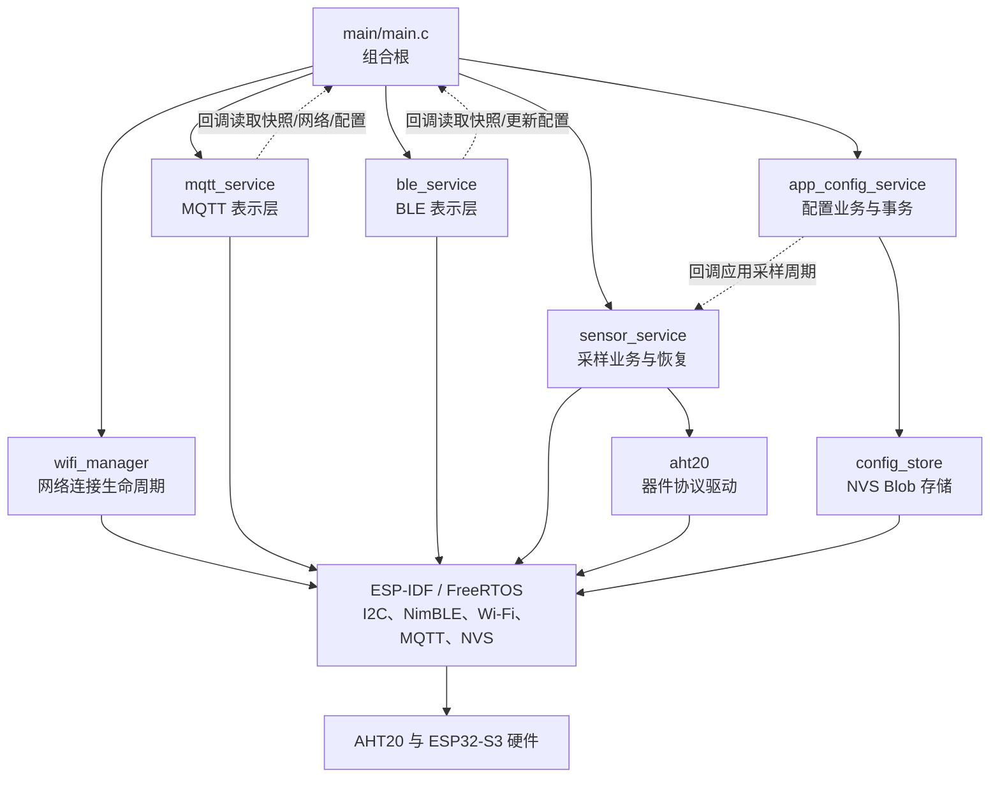
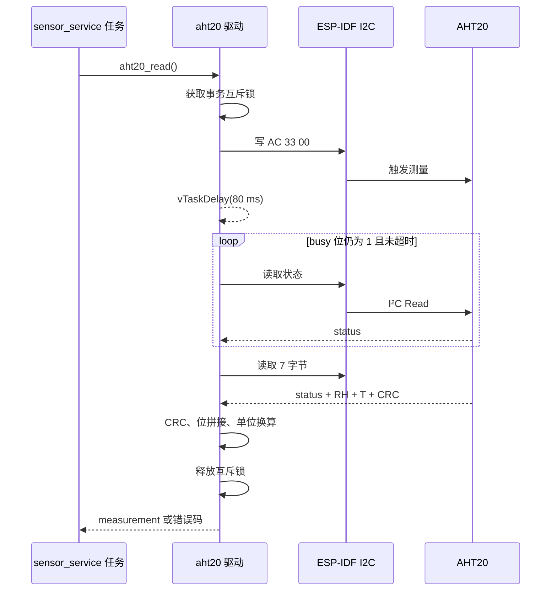
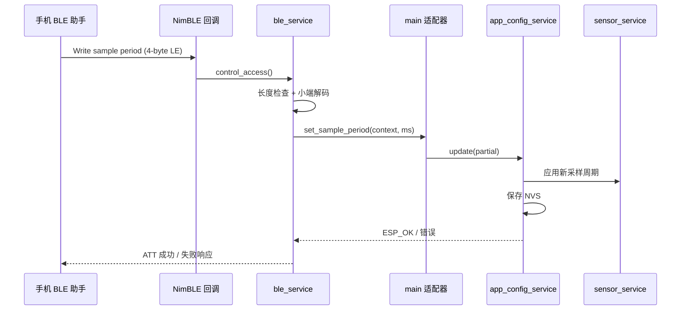
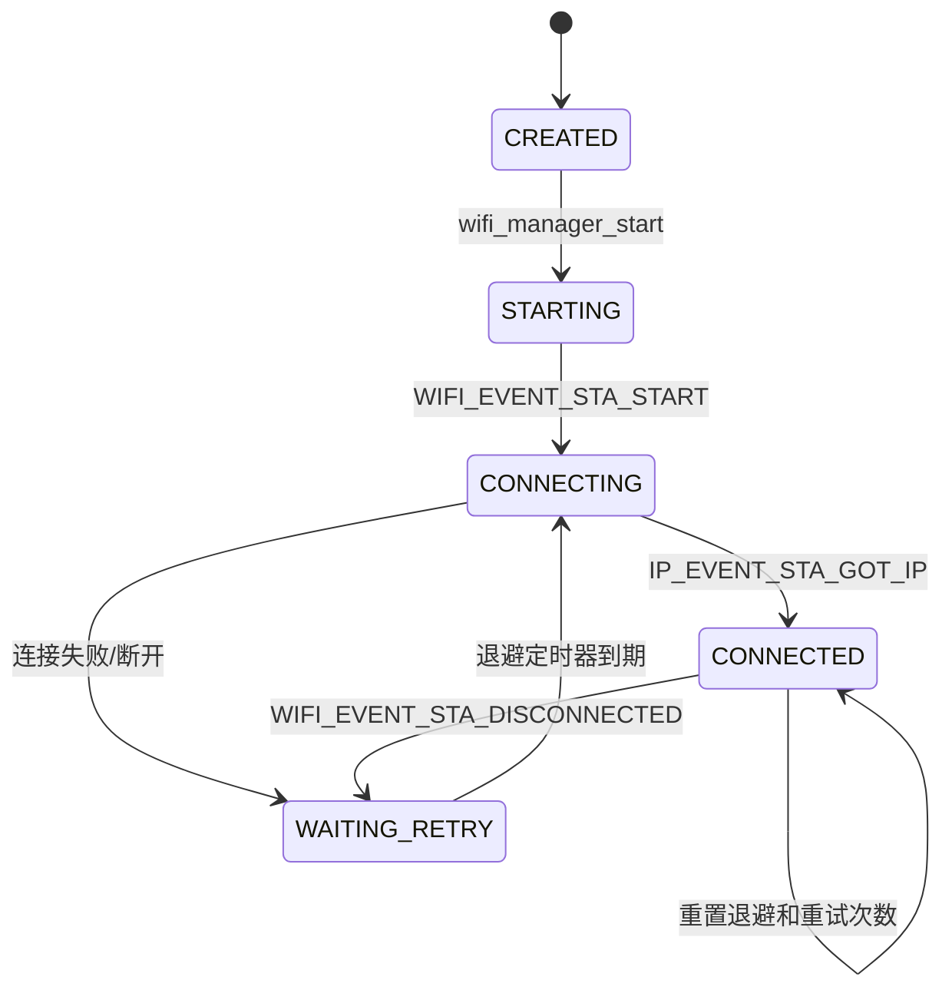
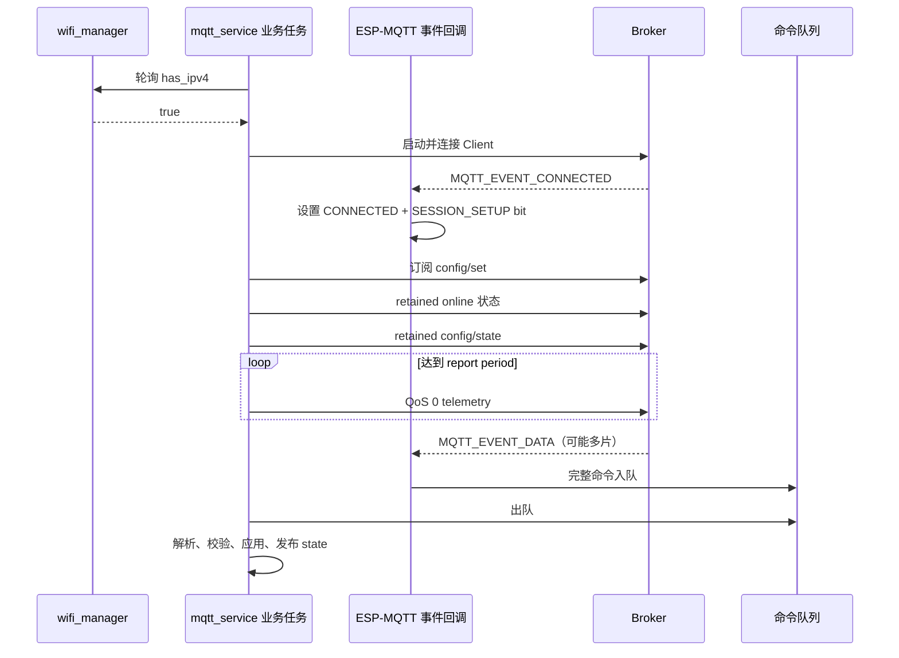
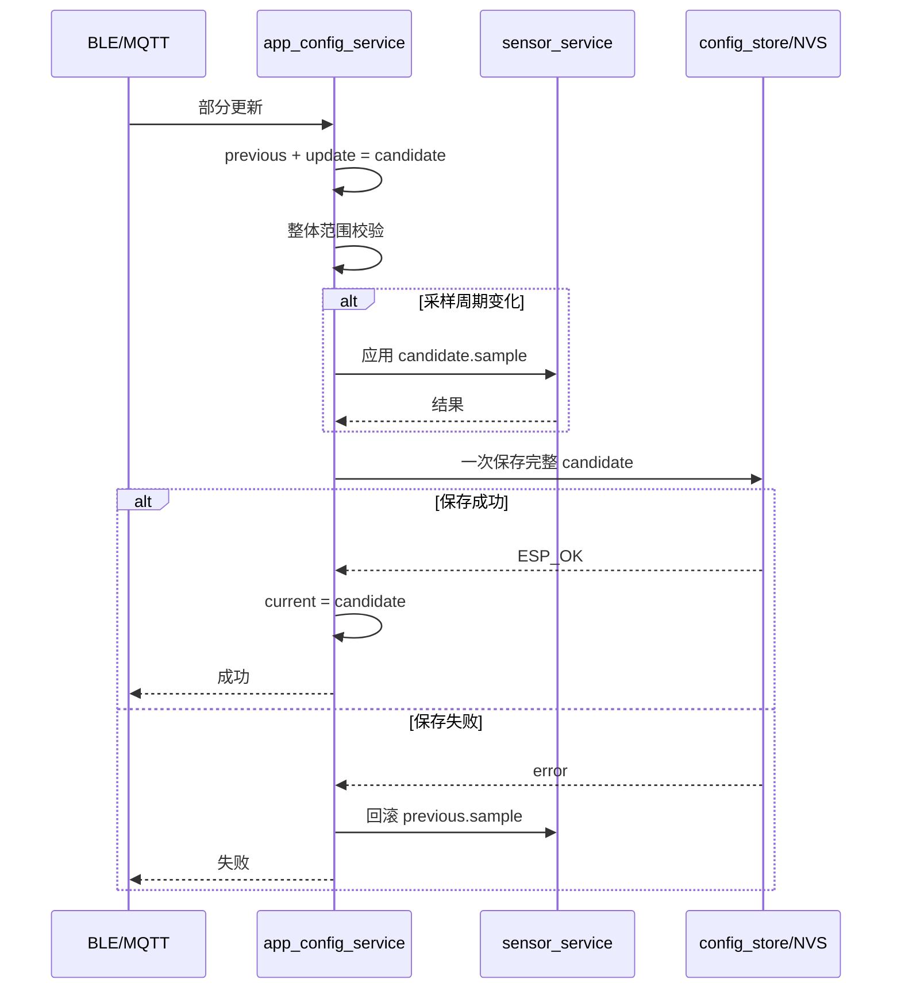
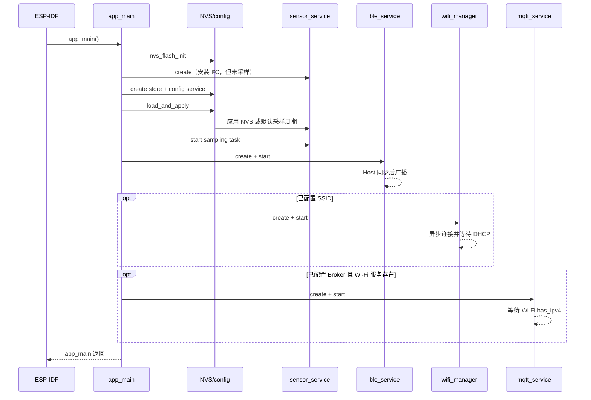

# 第一阶段代码学习指南：ESP32-S3 环境监测节点

> 适用工程：ESP32-S3 N16R8 + AHT20 + ESP-IDF 5.3.x
> 第一阶段范围：AHT20、FreeRTOS、BLE、Wi-Fi、MQTT、NVS 运行时配置持久化

## 1. 这份文档怎么用

这份文档不是逐行翻译源码，而是一张“代码地图”。建议每读一节，就在 VS Code 中打开对应的头文件和实现文件，使用 `Ctrl+单击` 跳转到函数定义，再结合日志观察程序行为。

推荐的学习循环是：

1. 先回答“这个组件负责什么、不负责什么”。
2. 只看 `.h` 文件，理解它向外承诺的接口。
3. 再看 `.c` 文件，找到公共函数调用的内部辅助函数。
4. 画出输入、输出、状态和失败分支。
5. 修改一个安全参数或增加一条日志，烧录验证自己的理解。
6. 最后合上源码，用自己的话复述调用链。

项目总览和实际操作命令仍以 [README](../README.md) 为准；本文重点解释“为什么这样设计”和“如何读懂它”。

---

## 2. 第一部分：理解本项目需要掌握的知识

下面不是要求一次学完的前置课程，而是本项目中真实出现的知识点。可以边读代码边补课。

### 2.1 C 语言基础

#### 必须掌握

- 固定宽度整数：`uint8_t`、`uint16_t`、`uint32_t`、`int64_t`，以及为什么通信协议不能随意用 `int`。
- 指针和空指针：输入指针、输出指针、`void *context` 的用途。
- `const`：表示只读承诺，帮助编译器和读者识别数据所有权。
- 结构体：配置结构、数据快照、状态结构、持久化记录。
- 枚举：把连接状态表示为有限集合，而不是含义不明的数字。
- 位运算：`&`、`|`、`<<`、`>>`，用于解析状态位和 20 位原始数据。
- 数组与长度：网络数据不是以 `\0` 结尾的普通字符串，必须同时携带长度。
- 函数指针与回调：通信组件通过回调取得数据，而不直接依赖传感器组件。
- 动态内存：`calloc()`、`free()`，以及创建失败后的资源清理。
- 文件作用域：`static` 函数和 `static` 全局变量只在当前 `.c` 文件可见。
- 错误码：`esp_err_t`、`ESP_OK`、失败立即返回、统一清理出口。

#### 在源码中重点观察

- `typedef struct xxx *xxx_handle_t`：不透明句柄模式。调用者知道“有一个对象”，但不能直接修改内部状态。
- `const xxx_config_t *config`：创建函数复制配置，之后组件拥有自己的配置副本。
- `out_handle`、`out_snapshot`：函数通过输出参数返回结果，通过返回值报告成功或失败。
- 先写局部完整结果，再赋给输出参数：避免调用者看到“只更新了一半”的数据。
- `_Static_assert`：在编译期固定 Flash 记录布局，避免结构变化悄悄破坏旧数据。

### 2.2 嵌入式硬件与数字通信基础

- 电压和供电：本板可由 USB 供电；AHT20 使用 3.3 V 与 ESP32-S3 的 I/O 电平一致。
- GPIO：引脚编号是芯片 GPIO 编号，不等同于排针的物理序号。
- I²C：主机、从机、7 位地址、SDA、SCL、START、STOP、ACK/NACK。
- 开漏与上拉：I²C 设备只能主动拉低总线，高电平依靠上拉电阻；内部上拉只能作为补充。
- 总线频率：本项目面包板连线默认 100 kHz，AHT20 支持最高 400 kHz。
- 时序约束：上电等待、初始化等待、测量转换时间、忙状态轮询和超时。
- 状态位：一个字节中的 bit 7 表示忙，bit 3 表示校准使能。
- 数据完整性：CRC 能发现通信中的位错误，但不能证明测量值一定符合现实环境。
- 传感器误差来源：手触摸、自热、板上热源、气流、冷凝、安装位置都会影响读数。

### 2.3 “寄存器操作”应该怎样理解

嵌入式开发中常见两类操作：

1. **MCU 内部外设寄存器**：例如直接配置 ESP32-S3 的 I²C 控制器寄存器。
2. **外部器件协议**：例如向 AHT20 地址 `0x38` 发送 `AC 33 00` 命令。

本项目使用 ESP-IDF 的 I²C 驱动，因此 ESP32-S3 内部寄存器由 `i2c_param_config()`、`i2c_driver_install()` 等框架 API 间接配置。我们编写的 `aht20` 组件关注第二类：按照 AHT20 数据手册构造命令、等待、读回并解析数据。

这是一条重要的工程原则：如果厂商 SDK 已提供成熟的底层外设驱动，业务项目通常先使用它；只有在调试底层、移植新芯片或有特殊性能要求时，才直接操作 MCU 寄存器。

### 2.4 ESP-IDF 工程与构建系统

- Project 与 Component 的区别。
- 根目录 `CMakeLists.txt` 如何引入 ESP-IDF 构建系统。
- 每个组件的 `idf_component_register()`：源码、公开头文件、组件依赖。
- `REQUIRES` 的含义：它既影响链接，也决定公开头文件搜索路径。
- `Kconfig.projbuild`：声明项目自己的 menuconfig 菜单。
- `sdkconfig`：当前机器实际选择的配置，可能包含 Wi-Fi/MQTT 凭据，因此本项目不提交。
- `sdkconfig.defaults`：安全、可共享的硬件和框架默认值；不会强行覆盖已有 `sdkconfig`。
- `sdkconfig.h`：构建时生成，代码通过 `CONFIG_APP_...` 宏读取选项。
- 分区表、NVS、应用固件空间，以及 N16R8 中 Flash 与 PSRAM 的含义。

配置的来源关系是：

```text
Kconfig 声明选项及默认值
        ↓
menuconfig 生成/修改 sdkconfig
        ↓
构建生成 sdkconfig.h
        ↓
C 代码读取 CONFIG_APP_xxx
```

### 2.5 FreeRTOS 与并发

- 任务：独立执行循环、栈大小、优先级、阻塞与调度。
- Tick：`pdMS_TO_TICKS()` 把毫秒换成调度器时间单位。
- `vTaskDelay()`：让出 CPU，而不是空转等待。
- 互斥锁：保护一个完整事务或一份共享状态。
- 队列：把 MQTT 网络回调收到的命令安全地交给业务任务。
- 事件组：用 bit 表示“已连接”“需要建立会话”“请求停止”等条件。
- Task Notification：轻量地唤醒正在等待的采样任务，让新周期立即生效。
- 软件定时器：Wi-Fi 退避结束后触发下一次非阻塞连接。
- 回调上下文：事件回调中不做长时间等待、复杂 JSON 解析或 Flash 写入。

需要形成的核心认识是：**共享数据的读写者不在同一个执行上下文中，就必须设计同步方式。**

### 2.6 BLE 基础

- GAP：广播、扫描、连接、设备名。
- GATT：服务、特征、属性、访问权限。
- UUID：SIG 标准 16 位 UUID 和项目自定义 128 位 UUID。
- Read、Write、Notify 的区别。
- CCCD：客户端开启通知后，服务端才会真正推送。
- MTU 与负载长度。
- 小端序：低位字节先传输。
- 定点协议：温度和湿度都按真实值乘 100 后发送，避免直接传 `float` 的兼容问题。

例如 `24.32 °C × 100 = 2432 = 0x0980`，小端字节就是 `80 09`；`70.93 %RH × 100 = 7093 = 0x1BB5`，小端字节是 `B5 1B`。调试助手显示十六进制并不是乱码，而是在展示二进制协议。

### 2.7 Wi-Fi 与 TCP/IP 基础

- Station（STA）模式：ESP32 作为客户端接入 2.4 GHz 热点。
- Wi-Fi 已关联不等于网络已经可用；获得 DHCP IPv4 后才把 `has_ipv4` 置为真。
- ESP-IDF 事件循环：`WIFI_EVENT` 与 `IP_EVENT` 是异步事件。
- 断线原因码只说明本次断开的类别，处理策略还应包含重试。
- 指数退避：1 s、2 s、4 s……直到最大 30 s，避免断网时高频重连。
- ESP32-S3 的 Wi-Fi 和 BLE 共用 2.4 GHz 射频资源，但共存由协议栈协调。

### 2.8 MQTT 基础

- Broker、Client、Topic、Publish、Subscribe。
- 通配符：MQTTX 订阅 `env/#` 可以观察本项目前缀下的全部消息。
- QoS 0 与 QoS 1：传感器遥测重时效，配置/状态更重可靠性。
- Retain：Broker 保存某个 Topic 的最后一条状态，新订阅者会立即收到。
- Last Will：设备异常掉线时，由 Broker 发布离线状态。
- Topic 是接口设计的一部分，应区分遥测、状态、命令和配置状态。
- MQTT 数据可能分片到达，不能假设一次事件就是完整 JSON。
- 网络回调与业务任务解耦：回调重组并入队，业务任务解析、校验、应用。

尤其要记住：`config/set` 是一次性命令，发布时不能开启 Retain；`config/state` 才是适合保留的当前状态。程序也增加了防御逻辑，拒绝 Broker 在重新订阅时回放的 retained 命令。

### 2.9 NVS 与可靠配置

- NVS 是 ESP-IDF 的键值存储，数据位于 Flash，断电后保留。
- Namespace + Key 定位一条记录。
- `nvs_set_blob()` 后还必须 `nvs_commit()` 才算提交。
- 编译默认值与运行时持久化值不是一回事。
- 记录需要 magic、version、size 和范围校验，才能面对升级或损坏。
- 多字段更新应先组成候选配置，整体校验后一次保存。
- Flash 保存失败时要回滚已应用的运行时值，避免“当前显示一个值、重启又是另一个值”。

本项目启动时的优先级是：

```text
有效 NVS 记录 > 编译进固件的项目默认值
```

MQTT Retain 不是设备持久化。Retain 存在 Broker 上；NVS 存在 ESP32 的 Flash 中。

### 2.10 企业式工程习惯

- 单一职责：驱动只懂协议，业务服务负责周期和恢复，通信层只懂通信模型。
- 依赖倒置：BLE/MQTT 通过函数指针获取数据，不包含 `sensor_service.h`。
- 生命周期成对：create/delete、start/stop、open/close、take/give。
- 创建失败清理：每一步失败都释放之前已经获得的资源。
- 边界校验：字符串长度、GPIO、频率、时间范围、JSON 类型、数据长度。
- 可观测性：状态快照、序列号、连续失败次数、最后错误码、结构化日志。
- 区分故障等级：基础资源创建失败则 fail-fast；传感器掉线属于运行期可恢复故障。
- 不提交秘密：本机 `sdkconfig` 和 `.vscode` 已加入忽略规则。

---

## 3. 系统全景图

### 3.1 分层与依赖方向



虚线很关键：BLE 和 MQTT 只认识自己定义的中立数据结构与回调签名，`main.c` 负责把它们适配到真实服务。这使通信方式可以替换，也避免组件互相包含形成依赖网。

### 3.2 三条主要数据流

| 数据流 | 起点 | 主要路径 | 终点 |
|---|---|---|---|
| 测量数据 | AHT20 | `aht20` → `sensor_service` 快照 | BLE Read/Notify、MQTT telemetry、串口日志 |
| 运行时命令 | BLE Write 或 MQTT `config/set` | 通信组件 → `main` 适配回调 → `app_config_service` | 采样任务、MQTT 上报调度、NVS |
| 网络状态 | ESP-IDF Wi-Fi/IP 事件 | `wifi_manager` 状态快照 → `main` 回调 | MQTT 是否可以启动连接 |

---

## 4. 推荐源码阅读顺序

不要按文件夹字母顺序读。建议按下面顺序建立理解：

1. [main/Kconfig.projbuild](../main/Kconfig.projbuild)：先认识所有可配置输入。
2. [sdkconfig.defaults](../sdkconfig.defaults)：区分共享默认值与本机实际配置。
3. 根 [CMakeLists.txt](../CMakeLists.txt) 和各组件 `CMakeLists.txt`：看清组件边界与依赖。
4. [main/main.c](../main/main.c)：只看对象创建顺序、回调适配和启动顺序。
5. 所有组件的 `.h`：把它们当成“合同”，先不要钻实现细节。
6. [aht20.h](../components/aht20/include/aht20.h) → [aht20.c](../components/aht20/aht20.c)：理解硬件协议。
7. [sensor_service.h](../components/sensor_service/include/sensor_service.h) → [sensor_service.c](../components/sensor_service/sensor_service.c)：理解任务、快照和恢复。
8. [ble_service.c](../components/ble_service/ble_service.c)：理解本地数据展示与控制。
9. [wifi_manager.c](../components/wifi_manager/wifi_manager.c)：理解异步事件状态机。
10. [mqtt_service.c](../components/mqtt_service/mqtt_service.c)：理解网络回调、队列和发布调度。
11. [config_store.c](../components/config_store/config_store.c) → [app_config_service.c](../components/app_config_service/app_config_service.c)：理解存储与业务事务为何要分层。

读每个 `.h` 时回答四个问题：

- 调用者必须提供什么？
- 成功后组件保证什么？
- 返回值如何表示失败？
- 创建出来的资源由谁、何时释放？

---

## 5. 从 AHT20 数据手册到驱动代码

### 5.1 阅读器件手册的顺序

面对一个新传感器，不要直接搜索示例代码复制。按以下顺序提取信息：

1. **电气条件**：供电、电平、功耗、上拉、去耦、电气极限。
2. **总线条件**：I²C/SPI/UART、地址、最大频率、读写帧格式。
3. **上电状态**：上电后要等多久，是否需要初始化或校准。
4. **命令表**：命令字、参数、命令后最短等待时间。
5. **状态机**：空闲、忙、已校准等状态如何判断。
6. **数据布局**：每一位属于哪个物理量，大小端如何排列。
7. **转换公式**：原始码怎样换算为工程单位。
8. **完整性校验**：CRC 初值、多项式、覆盖哪些字节。
9. **异常恢复**：超时、软复位、重新初始化。
10. **测量限制**：精度、响应时间、推荐采样间隔、热设计和环境影响。

### 5.2 手册条目如何落到本项目

| 手册信息 | 驱动中的表示 | 目的 |
|---|---|---|
| 7 位地址 `0x38` | `AHT20_DEFAULT_I2C_ADDRESS` | 正确寻址器件 |
| 上电后等待 | `AHT20_POWER_ON_DELAY_MS = 40` | 等传感器进入空闲状态 |
| 查询状态 `0x71` | 直接以读方向读取状态字节 | 检查 bit 3 / bit 7 |
| 初始化 `BE 08 00` | `aht20_write_command_unlocked()` | 未校准时初始化 |
| 测量 `AC 33 00` | `aht20_read()` | 触发一次转换 |
| 转换至少约 80 ms | 固定等待 + 有上限忙轮询 | 正常时可靠，异常时不永久卡死 |
| 6 字节数据 + CRC | 读取 7 字节帧 | 同时获得数据和校验值 |
| CRC 初值 `0xFF`、多项式 `0x31` | `aht20_calculate_crc8()` | 发现总线传输错误 |
| 20 位湿度与温度 | 位移、掩码、或运算 | 从跨字节字段还原整数 |
| 软复位 `0xBA` | `aht20_soft_reset()` | 连续失败后的恢复手段 |

### 5.3 初始化伪代码

```text
锁住整个 AHT20 事务
标记驱动未初始化
等待上电稳定
读取状态
如果 calibration bit 未置位：
    发送 BE 08 00
    等待 10 ms
    再读状态
    若仍未置位，返回状态错误
标记驱动已初始化
解锁
```

锁保护的是整个协议事务，而不只是一条 I²C API。否则任务 A 可能刚检查完状态，任务 B 就插入软复位，任务 A 随后读到的内容将不再符合预期。

### 5.4 测量伪代码

```text
检查参数并加锁
确认已经初始化
发送 AC 33 00
等待至少 80 ms
循环读取状态：
    busy 清零 -> 继续
    超过上限 -> 返回超时
读取 7 字节完整帧
再次检查 busy
校验前 6 字节的 CRC
还原两个 20 位原始数
套用温湿度公式
最后一次性写入调用者的输出结构
解锁并返回
```

### 5.5 跨字节数据怎样拼接

AHT20 的湿度占 `frame[1]`、`frame[2]` 和 `frame[3]` 高半字节：

```text
raw_humidity = frame[1] << 12
             | frame[2] << 4
             | frame[3] >> 4
```

温度使用 `frame[3]` 低半字节、`frame[4]`、`frame[5]`：

```text
raw_temperature = (frame[3] & 0x0F) << 16
                | frame[4] << 8
                | frame[5]
```

转换公式为：

```text
humidity_rh  = raw_humidity / 2^20 × 100
temperature  = raw_temperature / 2^20 × 200 - 50
```

建议拿一帧真实 Hex 数据，在纸上按位拼一次。能独立算出和日志相近的结果，就真正理解了这段驱动。

### 5.6 单次测量时序



---

## 6. 代码是按什么顺序设计出来的

写这种项目时，可以按“先稳定核心，再向外扩展”的顺序：

1. **写清需求和边界**：采什么、多久一次、怎样读、怎样远程改、失败怎么办。
2. **提取硬件手册事实**：地址、命令、时序、数据位、公式、CRC、恢复方法。
3. **先设计驱动头文件**：定义创建、初始化、读取、复位、删除；暂不创建任务。
4. **实现纯计算辅助函数**：CRC、字节拼接、单位转换最容易单独推理。
5. **实现设备事务**：加锁、发命令、等待、轮询、读帧、校验。
6. **增加传感器业务层**：配置 I²C、创建周期任务、维护最新快照、连续失败恢复。
7. **先定义中立数据模型**：BLE/MQTT 不应该知道 `aht20_measurement_t`。
8. **接入 BLE**：先 Read，再 Notify，再加入配置 Write。
9. **接入 Wi-Fi**：只完成 STA 状态机和重连，不夹带 MQTT 逻辑。
10. **接入 MQTT**：等待网络、构造 Topic、建立会话、遥测、命令队列。
11. **最后增加持久化**：通用 Blob 存储在下，配置校验与事务在上。
12. **在 `main.c` 组合**：注入回调，明确创建顺序与依赖关系。
13. **按故障场景验证**：拔传感器、关热点、关 Broker、发非法 JSON、重启设备。

之所以不从一个巨大的 `app_main()` 开始，是因为功能一多，硬件协议、任务循环、网络事件和配置保存会纠缠在一起，任何修改都可能影响其他部分。先确定组件接口，会迫使我们说清责任和依赖。

---

## 7. 各组件代码地图

### 7.1 `main/main.c`：组合根

**负责**：读取编译配置、创建组件、连接组件、决定启动顺序。
**不负责**：AHT20 命令、BLE 协议细节、Wi-Fi 重连算法、JSON 解析和 NVS 读写。

关键函数：

| 函数 | 作用 |
|---|---|
| `app_initialize_nvs()` | 初始化 NVS；仅在特定不可用状态下擦除并重试 |
| `app_apply_sensor_sample_period()` | 把配置服务回调适配到传感器服务 |
| `app_ble_get_snapshot()` | 把传感器快照转换成 BLE 中立模型 |
| `app_get_sample_period()` / `app_set_sample_period()` | 让 BLE 通过统一配置服务读写采样周期 |
| `app_start_wifi_if_configured()` | SSID 非空才创建并启动 Wi-Fi |
| `app_mqtt_get_snapshot()` | 把传感器快照转换成 MQTT 中立模型 |
| `app_mqtt_is_network_ready()` | 把 Wi-Fi 状态适配成一个布尔网络条件 |
| `app_mqtt_get_runtime_config()` | 配置服务模型 → MQTT 模型 |
| `app_mqtt_apply_runtime_config()` | MQTT 部分更新 → 配置服务部分更新 |
| `app_start_mqtt_if_configured()` | Broker 和 Wi-Fi 均存在才启动 MQTT |
| `app_main()` | 全应用装配和启动 |

`main.c` 中看似重复的数据复制是有意的“适配层”。如果 BLE 直接依赖 `sensor_service`，以后替换传感器或复用 BLE 组件都会更困难。

### 7.2 `aht20`：器件协议驱动

**负责**：AHT20 地址、命令、状态位、CRC、原始数据转换、单设备事务锁。
**不负责**：GPIO 选择、I²C 总线安装、周期采样、日志上报、无线通信。

公共 API 的生命周期：

```text
aht20_create → aht20_initialize → aht20_read ... → aht20_delete
                                      ↓失败恢复
                               aht20_soft_reset
                                      ↓
                               aht20_initialize
```

内部 `_unlocked` 函数表示“调用者必须已经持锁”，这种命名能避免同一互斥锁被重复获取。

### 7.3 `sensor_service`：采样业务层

**负责**：安装 I²C 主机、拥有 AHT20 实例、周期采样、线程安全快照、动态周期、连续失败恢复。
**不负责**：BLE/MQTT 的数据格式和 NVS。

内部有三类同步对象：

- `snapshot_mutex`：保护 `latest`，使 BLE/MQTT 获得一致快照。
- `config_mutex`：保护可运行时修改的采样周期。
- `control_events` + Task Notification：停止任务，并在周期变化时立即唤醒。

`sensor_service_task()` 是核心循环：

```text
未初始化 -> 尝试初始化
初始化成功 -> 读取一次
成功 -> 原子更新快照、序列号加一、失败计数清零
失败 -> 快照标无效、失败计数加一
每累计 3 次失败 -> 软复位并要求重新初始化
等待“周期剩余时间”或被通知提前唤醒
```

这里用“周期起点减去执行耗时”计算等待时间，因此尽量保持固定采样周期，而不是简单地在每次测量后再完整延迟一次。

### 7.4 `ble_service`：BLE 表示层

它建立两组 GATT 服务：

- 标准环境感知服务：温度、湿度，支持 Read/Notify。
- 项目控制服务：设备状态、采样周期，支持状态读取/通知和周期读写。

关键路径：

- `ble_service_build_gatt_table()`：把 UUID、权限、访问回调和值句柄组装成 GATT 表。
- `ble_service_environment_access()`：按属性句柄选择温度或湿度，并编码成 2 字节小端定点数。
- `ble_service_control_access()`：读取状态、读取周期或处理 4 字节周期写入。
- `ble_service_gap_event()`：处理连接、断开、订阅、MTU；断开后恢复广播。
- `ble_service_on_sync()`：NimBLE Host 就绪后确定本机地址并开始广播。
- `ble_service_notification_task()`：每 250 ms 检查快照，只在测量序列或状态变化时通知。



### 7.5 `wifi_manager`：Wi-Fi 生命周期

它将 ESP-IDF 的大量底层事件压缩为少量业务状态：`CREATED`、`STARTING`、`CONNECTING`、`WAITING_RETRY`、`CONNECTED`。

关键函数：

- `wifi_manager_create()`：复制凭据、创建同步资源、初始化 netif/事件循环/Wi-Fi、注册事件。
- `wifi_manager_start()`：调用 `esp_wifi_start()`，连接结果稍后通过事件到达。
- `wifi_manager_event_handler()`：响应 STA 启动、断开、获得 IP。
- `wifi_manager_schedule_reconnect()`：安排有上限的指数退避。
- `wifi_manager_reconnect_timer_callback()`：定时器到期后发起非阻塞连接。
- `wifi_manager_get_status()`：复制线程安全状态，不暴露 ESP-IDF 事件细节。



### 7.6 `mqtt_service`：云侧数据与控制

**负责**：MQTT Client、Topic、会话恢复、遥测调度、命令重组、JSON 校验、调用配置回调。
**不负责**：Wi-Fi 如何连接、传感器如何采样、NVS 如何保存。

Topic 设计：

| Topic | 方向 | QoS / Retain | 含义 |
|---|---|---|---|
| `env/<id>/telemetry` | ESP32 → Broker | QoS 0 / 否 | 当前温湿度与运行信息 |
| `env/<id>/status` | ESP32/Broker → 客户端 | QoS 1 / 是 | online/offline，含 Last Will |
| `env/<id>/config/set` | 控制端 → ESP32 | QoS 1 / **否** | 一次性配置命令 |
| `env/<id>/config/state` | ESP32 → Broker | QoS 1 / 是 | 当前权威配置状态 |

关键函数分为三组：

1. **协议回调组**：`mqtt_service_event_handler()`、`mqtt_service_receive_command_fragment()`。只更新状态、重组数据、投递队列。
2. **业务处理组**：`mqtt_service_process_command()`、`mqtt_service_json_seconds_to_ms()`。解析并验证 JSON，调用配置服务。
3. **发布调度组**：`mqtt_service_task()`、`mqtt_service_setup_session()`、`mqtt_service_publish_telemetry()`、`mqtt_service_publish_config_state()`。



#### 为什么 MQTTX 会“自己显示自己发的消息”

MQTTX 同时订阅了 `env/#`，又向这个范围内的 Topic 发布，所以 Broker 会把消息分发回这个订阅客户端。这是标准发布/订阅行为，不代表 ESP32 重复发送。

#### Retained 命令的防御逻辑

当设备重新订阅时，Broker 会回放 Topic 上的 retained 消息，并标记 `retain`。`mqtt_service_receive_command_fragment()` 在接收新消息首片时检查该标志；如果它来自 `config/set`，就拒绝并计入 rejected counter。这样旧 Broker 命令不会在复位后覆盖 NVS 已恢复的配置。

这层防御不能替代正确使用 MQTTX：仍应关闭 `config/set` 的 Retain，并用空 retained 消息清除 Broker 上已有的旧值。

### 7.7 `config_store`：通用存储适配器

这个组件只知道“保存一个 Blob”，不知道采样周期和上报周期是什么。

- `config_store_create()`：复制 namespace 和 key。
- `config_store_load()`：先查询 Blob 长度，再检查调用者缓冲区，再读取。
- `config_store_save()`：`nvs_set_blob()` 后 `nvs_commit()`。
- `config_store_erase()`：删除 key 并提交；key 不存在视为成功。
- `config_store_delete()`：只释放 RAM 对象，不删除 Flash 数据。

把通用 NVS 操作独立出来，可以让上层配置格式升级，而不用把 NVS API 散落在 BLE 和 MQTT 里。

### 7.8 `app_config_service`：配置业务与事务

持久化记录包含：magic、version、size、sample period、report period、reserved。NVS 已提供 Blob 的底层 CRC，本层再检查版本、长度和业务范围。

`app_config_service_load_and_apply()`：

```text
尝试从 NVS 读取
若记录存在且格式/范围有效 -> 选 NVS 值
若不存在 -> 选项目默认值
若损坏/版本不兼容 -> 删除坏记录并选默认值
把采样周期应用到 sensor_service
最后更新配置服务自己的状态
```

`app_config_service_update()` 是本阶段最值得学习的“事务式更新”：



这里的“权威当前值”是 `app_config_service.status.values`。只有 NVS 保存成功后才更新它，因此日志中的 active、saved 和重启后的值保持一致。

---

## 8. 整机启动时序



`app_main()` 返回不是程序结束。它创建的 FreeRTOS 任务、NimBLE Host、Wi-Fi 事件循环和 MQTT Client 仍在运行。

启动顺序也体现依赖关系：配置服务必须在 BLE/MQTT 前可用，MQTT 必须有 Wi-Fi 状态来源，传感器快照提供者必须先创建。

---

## 9. 谁在什么时候运行：任务与回调模型

| 执行上下文 | 主要代码 | 可以做什么 | 应避免什么 |
|---|---|---|---|
| `main_task` | `app_main()` | 初始化和装配 | 永久循环、长期阻塞 |
| `sensor_service` task | 周期采样、恢复 | I²C 事务、延迟等待、写快照 | 直接调用 BLE/MQTT |
| NimBLE Host task | GAP/GATT 回调 | 快速编码/解码、调用轻量回调 | 长时间处理、无界等待 |
| `ble_notify` task | 检查快照变化 | 触发特征更新 | 高频无条件发送 |
| ESP event loop | Wi-Fi/IP 回调 | 改状态、安排重连 | 阻塞等待网络 |
| `esp_timer` task | 重连定时器回调 | 发起非阻塞连接 | 睡眠或复杂业务 |
| ESP-MQTT task | MQTT 事件回调 | 改 bit、重组分片、命令入队 | JSON 解析、Flash 写入 |
| `mqtt_service` task | 会话、发布、命令业务 | JSON、配置调用、周期调度 | 绕过配置服务改状态 |

### 9.1 共享资源及保护方式

| 共享资源 | 写者 | 读者 | 保护方式 |
|---|---|---|---|
| 最新传感器快照 | sensor task | BLE、MQTT | `snapshot_mutex` + 整体结构复制 |
| 采样周期 | 配置回调 | sensor task | `config_mutex` + task notification |
| Wi-Fi 状态 | event loop/timer | MQTT、诊断 | `status_mutex` |
| MQTT 状态 | MQTT 回调/业务 task | 诊断 | `status_mutex` |
| 完整 MQTT 命令 | MQTT callback | MQTT business task | FreeRTOS queue |
| 配置当前值 | BLE/MQTT 路径 | BLE/MQTT/启动逻辑 | config service mutex |
| AHT20 事务状态 | 任意驱动调用者 | 任意驱动调用者 | AHT20 device mutex |

---

## 10. 错误处理与恢复矩阵

| 故障 | 发现位置 | 当前处理 | 设计理由 |
|---|---|---|---|
| I²C/任务/互斥锁创建失败 | `sensor_service_create()` | 返回错误，`ESP_ERROR_CHECK` 停止启动 | 基础资源缺失，应用无法正确运行 |
| AHT20 未连接或 CRC 错误 | sensor task | 快照无效、记录错误、持续重试 | 外设可能稍后恢复，不应反复重启整机 |
| AHT20 连续 3 次失败 | sensor task | 软复位并重新初始化 | 尝试解除器件卡死 |
| Wi-Fi 断开 | Wi-Fi event | 清除 IP、指数退避重连 | 网络故障通常是暂时的 |
| Broker 断开 | MQTT event/client | 状态置断开，由 Client 重连 | 不影响本地采样与 BLE |
| MQTT 分片乱序/过长 | MQTT callback | 丢弃并计数 | 防止缓冲区越界和半包解析 |
| 非法 JSON/越界周期 | MQTT business task | 拒绝，不改变当前配置 | 输入边界不可信 |
| retained `config/set` | MQTT callback | 拒绝并提示清除 | 防止旧命令在重启后重放 |
| NVS 记录不存在 | config service | 使用项目默认值 | 第一次启动的正常情况 |
| NVS 记录损坏/版本错误 | config service | 删除坏记录，使用默认值 | 保证总能得到安全配置 |
| NVS 保存失败 | config service | 回滚运行时采样周期 | 保持 RAM 与 Flash 一致 |

观察错误处理时，不只看“有没有判断返回值”，还要问：失败后状态是否一致？锁是否释放？资源是否泄漏？下一次能否恢复？调用者是否获得了可诊断信息？

---

## 11. 两条完整调用链练习

### 11.1 一次温度如何到达 MQTTX

按顺序在源码中查找：

1. `sensor_service_task()` 调用 `aht20_read()`。
2. `aht20_read()` 触发测量、校验 CRC、换算为浮点工程值。
3. `sensor_service_record_success()` 在锁内更新 `latest` 和序列号。
4. `mqtt_service_task()` 到达上报周期，调用 `mqtt_service_publish_telemetry()`。
5. MQTT 组件通过 `app_mqtt_get_snapshot()` 取得中立快照。
6. `snprintf()` 生成 JSON。
7. `esp_mqtt_client_publish()` 发布到 `env/<id>/telemetry`。
8. Broker 按订阅 `env/#` 把消息分发给 MQTTX。

### 11.2 MQTTX 修改周期如何在复位后仍然有效

1. MQTTX 向 `env/<id>/config/set` 发布非 retained JSON。
2. ESP-MQTT 触发 `MQTT_EVENT_DATA`。
3. `mqtt_service_receive_command_fragment()` 验证 Topic、Retain、长度、顺序，完整后入队。
4. `mqtt_service_task()` 出队并调用 `mqtt_service_process_command()`。
5. cJSON 解析字段并把秒精确转换成毫秒。
6. `app_mqtt_apply_runtime_config()` 转换模型，调用 `app_config_service_update()`。
7. 配置服务生成完整 candidate、校验、应用采样周期、保存 NVS。
8. MQTT 发布 retained `config/state`，供 MQTTX 观察权威结果。
9. 设备复位后 `app_config_service_load_and_apply()` 从 NVS 恢复该值。

注意，第 8 步用于“告诉其他客户端当前状态”，第 9 步才是“设备自己的断电持久化”。

---

## 12. 如何真正学会，而不是只把代码跑起来

### 12.1 建议完成的源码练习

1. 给 `aht20_read()` 的每个可能返回点写出错误来源表。
2. 任选一帧 7 字节 AHT20 数据，手算 CRC、20 位原始值和温湿度。
3. 解释为什么 `sensor_service_get_latest()` 要复制整个结构，而不是返回内部指针。
4. 解释为什么 BLE 温湿度传 2 字节定点数而不是 ASCII 或 `float`。
5. 用纸画出 Wi-Fi 从断开到 1/2/4/8/16/30 秒重试的状态变化。
6. 解释 MQTT 回调为什么只入队，不直接调用 cJSON 和 NVS。
7. 模拟“采样周期应用成功，但 NVS 保存失败”，逐行跟踪回滚。
8. 解释 `config/set` 和 `config/state` 的 Retain 选择为什么相反。
9. 找出所有 `calloc()`，检查每条失败路径是否最终 `free()`。
10. 找出所有 mutex，列出它保护的字段以及持锁范围。

### 12.2 建议完成的安全小改动

- 修改 BLE 设备名，预测哪些日志和扫描结果会变化。
- 修改编译默认上报周期，先擦除 NVS 后验证它何时生效。
- 在 MQTT telemetry 中增加 `consecutive_failures`，但不让 MQTT 组件依赖传感器头文件。
- 给非法 MQTT 字段增加更精确的日志，保持回调仍然轻量。
- 临时拔掉 AHT20，观察 valid、failure count、软复位和恢复后的 sequence。

每次只改一个变量，并在修改前写下预期日志。实际结果与预期不一致的地方，往往正是最值得学习的地方。

### 12.3 掌握程度检查表

当你能不看本文回答下面问题，就基本掌握了第一阶段：

- [ ] 能从 AHT20 手册独立写出初始化和测量时序。
- [ ] 能解释 I²C 上拉、地址、ACK、CRC 和超时的作用。
- [ ] 能从 7 字节帧还原温湿度。
- [ ] 能解释驱动层与业务层为什么分开。
- [ ] 能说出本项目有哪些任务、事件回调以及它们的同步手段。
- [ ] 能解释 BLE Read/Write/Notify、CCCD、小端和定点数。
- [ ] 能解释 Wi-Fi 获得 IP 与仅连接 AP 的区别。
- [ ] 能解释 MQTT QoS、Retain、Last Will、Topic 和分片。
- [ ] 能说明 Kconfig、sdkconfig、编译默认值、NVS 值之间的关系。
- [ ] 能跟踪一条 MQTT 配置命令直到 NVS，并解释失败回滚。
- [ ] 能区分“启动不可恢复错误”和“运行期可恢复错误”。
- [ ] 能新增一个组件接口，而不是把逻辑直接塞进 `main.c`。

---

## 13. 第一阶段常见误区总结

### USB 供电

开发板可以通过 USB Type-C 供电和烧录。连接 AHT20 时使用板载 `3V3` 与 `GND`，不要把传感器直接接到不确定的 5 V I/O 信号。

### 天线座

你的板子默认使用 PCB 天线，可外接天线不影响本阶段功能；不要随意改射频选路元件。

### BLE 的“乱码”

GATT 特征传的是二进制协议。调试助手用文本解释二进制自然像乱码；切换 Hex 后再按小端和缩放系数解析。

### `Kconfig.projbuild` 默认值修改后 menuconfig 没变化

默认值通常只在还没有选择值时使用。已有 `sdkconfig` 保存了旧值，应在 menuconfig 中修改，或明确重建配置；不能把“默认值”当成强制覆盖。

### MQTTX 发一条却看到一条

因为 MQTTX 自己订阅了包含该 Topic 的 `env/#`，Broker 正常把发布消息分发回来。

### 修改上报周期后仍像旧周期

先看 ESP32 返回的 `config/state` 和 `Configuration saved` 日志，确保发往正确设备 Topic，并确认 `config/set` 未开启 Retain。还要区分 2 秒采样日志与 MQTT telemetry 上报周期，它们是两个独立周期。

### Retain 与持久化

命令不应 Retain；状态适合 Retain；设备配置持久化由 NVS 完成。三者不能混为一谈。

---

## 14. 下一阶段前的建议

第一阶段已经形成完整闭环：采集、近场访问、联网、消息发布、远程配置、持久化和基本故障恢复。此时继续堆功能的收益低于先把调用链真正读懂。

建议先按第 12 节完成一轮源码学习。下一阶段再选择一个明确主题，例如：

- TLS 与 MQTT 身份认证；
- OTA 固件升级与回滚；
- 深度睡眠、功耗测量和断线补偿；
- 本地网页配网；
- 自动化测试与硬件在环测试。

一次只选择一个主题，继续保持“底层能力组件—业务服务—通信表示层—组合根”的结构。

---

## 15. 术语速查

| 术语 | 含义 |
|---|---|
| HAL/Driver | 隐藏硬件或协议细节的驱动层 |
| Opaque Handle | 只暴露指针类型、不公开内部结构的不透明句柄 |
| Snapshot | 在锁保护下复制出的某一时刻完整状态 |
| Callback | 把函数和上下文交给另一个组件，供其需要时调用 |
| Composition Root | 创建对象并连接依赖的应用入口，本项目即 `main.c` |
| Transaction | 多步操作要么整体成功，要么回滚到原状态 |
| Fail-fast | 基础条件不成立时立即停止，避免带病运行 |
| Backoff | 失败后逐渐延长重试间隔 |
| Idempotent | 重复执行仍得到相同有效结果 |
| Wire Format | 真正在 BLE/MQTT/总线上传输的字节格式 |
| Endianness | 多字节数值的字节排列顺序 |
| Retain | Broker 保存 Topic 最后一条消息的 MQTT 标志 |
| Last Will | Client 异常掉线后由 Broker 代发的遗嘱消息 |
| NVS | ESP-IDF 的非易失键值存储 |
