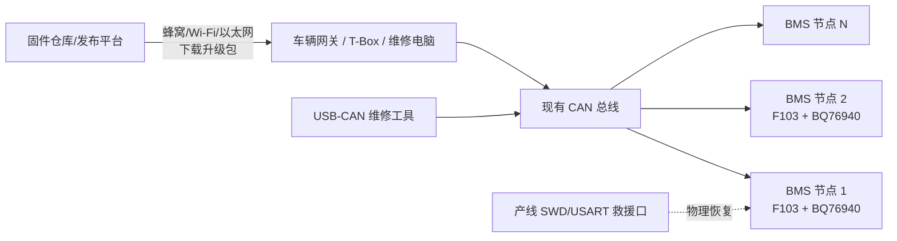
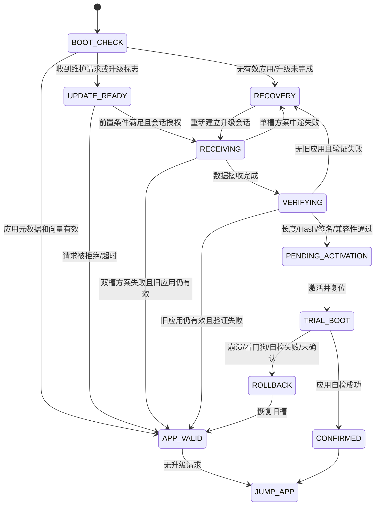
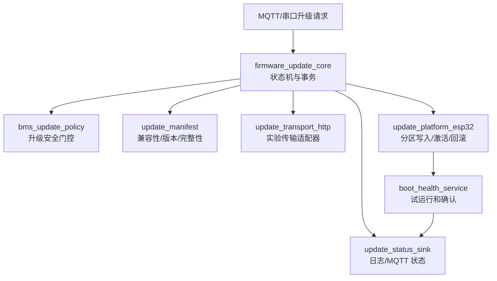

# 第二阶段设计：以 BMS 产品为目标的固件升级、恢复与回滚方案

> 目标产品视角：STM32F103 + BQ76940 的 BMS 控制器<br>
> 当前实验载体：ESP32-S3 N16R8 环境监测节点<br>
> 本阶段原则：ESP32 代码是“翻译工具”，BMS 的升级思想、状态机、故障模型和安全约束才是学习目标

## 1. 文档目的

本方案回答四个核心问题：

1. BMS 产品到底应该通过 Wi-Fi、BLE、CAN、UART 还是其他方式升级？
2. STM32F103 资源有限时，怎样区分真正的回滚与仅可恢复升级？
3. BMS 升级与普通物联网设备 OTA 相比，多了哪些安全、功耗和现场约束？
4. 怎样在 ESP32-S3 上构建可运行实验，又保证学到的架构能够迁移回 F103 BMS？

本文首先用于架构和调试方案冻结。当前仓库已按本文完成 A/B 分区、启动确认/回滚、基础升级状态机、HTTP 适配器和 ESP32 分区适配器；正常升级、故障回滚、Manifest、发布序号和流式 SHA-256 均已完成实机验证。BMS 专用门控和 MQTT 升级管理面暂不继续扩写，等待 BMS 项目重新启动后单独研究。

---

## 2. 先给出决策结论

### 2.1 推荐的企业产品方案

如果 BMS 产品本来就具备 CAN 收发器和对外 CAN 接口，推荐采用下面的分层升级方式：

| 使用阶段 | 推荐通道 | 说明 |
|---|---|---|
| 研发与产线首次烧录 | SWD | 下载快、可擦除全片、可调试、可恢复 Bootloader |
| 产线批量配置/维修兜底 | SWD 测试点或 USART1 + BOOT0/RESET 测试点 | 即使自定义 Bootloader 损坏，仍有物理恢复路径 |
| 售后本地升级 | USB-CAN 维修工具 → BMS CAN | 不给每个产品增加无线模块 |
| 整车/系统现场升级 | T-Box、VCU、主控或网关 → CAN → BMS | 无线能力集中在系统网关，BMS 节点只处理 CAN IAP |
| 实验室 ESP32 验证 | PC HTTP Server → Wi-Fi → ESP32 OTA | 用成熟 OTA 平台验证状态机、A/B、回滚和故障注入 |

所以“最好的升级方式”不是单独选择 Wi-Fi 或 BLE，而是：

> **BMS 节点复用现有 CAN；无线下载能力集中在一个网关或维修工具；SWD/USART 保留为最终救援通道。**

这样把无线模块的成本、认证、功耗和安全维护从每一块 BMS 板集中到少量网关设备上。

### 2.2 为什么不推荐每块 BMS 都放 Wi-Fi

- Wi-Fi 连接、扫描、关联和安全握手的瞬时功耗明显高于休眠 MCU。
- 增加 RF 模块、天线、供电去耦、布局空间和可能的认证成本。
- 每一个 BMS 节点都成为可远程访问的网络端点，攻击面和密钥管理成本上升。
- 地库、金属电池箱、车辆内部或工业现场不保证 Wi-Fi 覆盖。
- F103 本身不能直接运行完整 Wi-Fi/TLS 协议栈，需要外部模块及模块固件维护。
- 升级是低频操作，没有必要为低频功能长期承担每台产品的硬件成本。

Wi-Fi 适合网关、T-Box、研发板和固定基础设施，不一定适合每个 BMS 从节点。

### 2.3 BLE 为什么也不是默认答案

BLE 的平均功耗可以很低，手机维护也方便，但仍会带来：

- 每块产品增加 BLE 芯片/模块、天线和物料成本；
- 手机 App、配对、权限、兼容性和售后流程成本；
- 金属外壳和安装位置可能导致近场连接质量不稳定；
- 需要设计身份认证，不能把“距离近”当成安全；
- 大批设备升级时需要逐台靠近，运维效率可能很低。

BLE 可以作为高端型号或维修附件的可选能力，但不应在尚未明确使用场景时成为所有 BMS 的强制配置。

### 2.4 CAN 为什么最适合这个 BMS

- BMS 通常已经需要 CAN 上报电压、温度、SOC、故障和控制状态。
- 复用现有收发器、隔离、线束和连接器，边际 BOM 最低。
- 工业与车辆现场已有 USB-CAN、VCU、T-Box 等工具链。
- 支持一个网关管理多个 BMS 节点。
- 可以把升级流量和正常业务流量进行带宽、优先级和时间窗口管理。
- 升级时虽然 CAN 和 MCU 仍耗电，但这是受控维护窗口中的短时功耗，不是常态待机功耗。

需要注意：CAN 只提供物理层和数据链路层能力，不自动提供镜像分片、认证、版本策略和断电恢复。这些仍要由 Bootloader 和上位机协议完成。

---

## 3. 需要先确认的 BMS 产品信息

“STM32F103”不是足够精确的料号。开始 F103 方案设计前必须确认：

- 完整 MCU 型号，例如 STM32F103C8T6、CBT6、RCT6、VET6；
- 实际可用 Flash 和 SRAM 容量；
- 当前 Bootloader 和应用固件大小；
- 是否已有外部 SPI Flash/EEPROM；
- CAN 收发器型号、是否隔离、是否具有 standby/wake 功能；
- CAN 总线拓扑、波特率、节点数量和可接受升级占用率；
- BOOT0、RESET、USART1、SWD 是否保留测试点；
- 低压供电来源以及升级期间掉电风险；
- 接触器、MOSFET、预充、均衡和 BQ76940 保护链路的默认安全状态；
- 产品是教学、储能、工业设备还是道路车辆；
- 是否要求无人值守远程升级、自动回滚和防降级；
- 标定数据、序列号、累计运行数据保存在哪里。

在这些信息未知时，本文给出的是产品级决策框架，而不是可以直接量产的 Flash 地址表。

---

## 4. 一个必须澄清的事实：F103 ROM Bootloader 不等于 CAN IAP

STM32 内部有 ST 固化在 System Memory 中的 ROM Bootloader，也可以在用户 Flash 中编写自己的 IAP Bootloader，两者不是一回事。

### 4.1 常见 STM32F103 的 ROM Bootloader

ST 的 AN2606 对 F1 系列列出的结果是：

- STM32F10xxx 低密度、中密度和高密度：ROM Bootloader 使用 USART1；
- STM32F105xx/107xx 连接型产品：ROM Bootloader 才列出 USART、CAN2 和 USB DFU；
- 具体支持情况必须以完整料号和对应 AN2606 表格为准。

因此，对普通 STM32F103 BMS：

- USART1 ROM Bootloader 可以作为工厂或维修救援手段；
- 不能假设 BOOT0 拉高后就能直接通过 CAN 下载；
- 现场 CAN 升级通常需要在用户 Flash 起始区域实现自定义 CAN IAP Bootloader。

### 4.2 自定义 IAP Bootloader

自定义 Bootloader 位于用户 Flash 起始地址，负责：

- 上电后的启动决策；
- 初始化最小安全硬件和通信接口；
- 接收升级包；
- 擦除、写入、校验应用区域；
- 保存升级状态；
- 设置向量表并跳转到应用；
- 在不完整升级时保持可恢复状态。

ST 的 AN2557 示例说明了典型思想：Bootloader 位于 Flash 起始区域，应用链接到偏移地址，并将中断向量表重定位到应用起始地址。示例地址不能直接照搬，必须按实际芯片容量和 Bootloader 大小重新规划。

---

## 5. 更新系统的完整产品架构



企业系统最好把“包的远程分发”和“ECU 的本地安装”分开：

- 网关负责互联网、证书、断点下载、缓存和升级活动管理；
- BMS 仍必须独立检查目标型号、版本、长度、完整性和授权；
- BMS 不应仅因为消息来自车内 CAN 就无条件信任；
- 无网关场景下，维修电脑通过 USB-CAN 执行相同的 BMS 升级协议。

---

## 6. 通信方式决策矩阵

| 方案 | 单机增量成本 | 常态功耗影响 | 批量/远程能力 | 现场可用性 | 安全与软件复杂度 | 建议定位 |
|---|---:|---:|---:|---:|---:|---|
| SWD | 极低，仅测试点 | 无 | 无 | 必须拆机/接触板卡 | 低 | 产线与最终救援 |
| USART1 ROM Bootloader | 低 | 无 | 低 | 需要 BOOT0/RESET/串口接触 | 中 | 维修兜底 |
| 自定义 UART IAP | 低 | 无 | 低 | 需要串口接口 | 中 | 台架调试 |
| 自定义 CAN IAP | 若已有 CAN 则很低 | 维护期间短时增加 | 高，可由网关转发 | 适合整车/工业网络 | 中到高 | **BMS 主升级通道** |
| 每机 BLE | 中 | 低到中 | 逐台近场 | 依赖 App 和射频环境 | 高 | 可选售后功能 |
| 每机 Wi-Fi | 中到高 | 较高 | 高 | 依赖覆盖和配网 | 很高 | 不建议作为 F103 BMS 默认方案 |
| 网关无线 + 节点 CAN | 无线成本集中在网关 | 节点几乎不增加常态功耗 | 高 | 适合系统级部署 | 高但可集中管理 | **推荐整机架构** |

这里“最优”取决于全生命周期成本，不只看一颗模块的采购价，还要计算：

- PCB、天线、EMC、认证和装配；
- 手机/PC 工具开发；
- 密钥注入和证书生命周期；
- 售后工时和批量升级效率；
- 升级失败后的返修成本；
- 产品十年生命周期内的固件仓库与版本追踪。

---

## 7. 真正回滚与可恢复升级的区别

这是 F103 方案最容易被误解的地方。

### 7.1 可恢复升级

```text
Bootloader 保持完整
        ↓
擦除旧 Application
        ↓
边接收边写入新 Application
        ↓
断电或失败后 Application 可能不存在
        ↓
下次仍进入 Bootloader，等待重新下载
```

设备不会永久变砖，但必须重新连接上位机完成升级。它不能自动恢复旧业务程序，因此属于“可救援”，不是真正回滚。

### 7.2 真正回滚

```text
旧镜像始终保留
        ↓
把新镜像完整写入另一个槽位或外部存储
        ↓
验证新镜像
        ↓
试运行新镜像
        ↓
失败时重新启动旧镜像
```

真正回滚至少需要同时保存一份旧镜像和一份新镜像，或者有可靠的“黄金镜像”。

### 7.3 F103 上的三种存储策略

#### 方案 A：内部 Flash 单应用槽

```text
| 受保护 Bootloader | 冗余元数据 | Application |
```

优点：

- 不增加硬件成本；
- 适合 64/128 KiB 等容量较小的常见 F103；
- Bootloader 未损坏时可以通过 CAN/UART 反复恢复。

缺点：

- 擦除旧应用后无法自动回滚；
- 升级期间断电会让设备停留在 Bootloader；
- 不适合要求无人值守恢复的场景。

#### 方案 B：内部 Flash 双槽

```text
| Bootloader | 元数据 | Slot A | Slot B |
```

仅当实际 F103 Flash 容量、Bootloader 大小和固件大小允许时采用。不能因为型号都叫 F103 就假设一定装得下两份应用。

优点：没有外部器件，可以实现试运行与回滚。<br>
缺点：占用两倍应用空间，需要自己实现槽位选择和状态管理。

#### 方案 C：外部 SPI NOR 暂存/黄金镜像

```text
内部 Flash：| Bootloader | 元数据 | Application |
外部 Flash：| 下载暂存区 | 可选旧镜像/黄金镜像 |
```

优点：

- 可先完整下载并校验，再擦除内部应用；
- 复制过程中断电后可由 Bootloader 继续安装；
- 容量允许时可以保留旧镜像或黄金镜像。

缺点：增加器件、PCB、驱动、供应链和失效模式；仍需设计复制进度的断电一致性。

### 7.4 推荐原则

- 教学/本地可维修设备：方案 A 足够学习完整 IAP 和断电恢复。
- 无人值守、现场难接触设备：至少方案 B 或 C。
- 如果安全目标明确要求自动回滚，而现有 F103 容量不足，应该更换具备更大 Flash、双 Bank 或更强安全能力的 MCU，而不是用软件勉强掩盖硬件限制。

---

## 8. BMS 升级的安全门控

普通传感器节点升级失败可能只是暂时没数据；BMS 升级期间如果失去保护和执行控制，后果完全不同。

### 8.1 进入升级前必须检查

下列条件应由产品安全需求决定，典型条件包括：

- 接触器/MOSFET 已进入定义的安全状态；
- 不在充电、放电、预充和均衡过程中；
- 电流接近零并保持一段去抖时间；
- 电芯电压、温度处于允许维护的范围；
- 没有必须由应用持续处理的紧急故障；
- 低压电源稳定，最好有外部维护电源；
- CAN 总线处于允许诊断编程的会话；
- 目标硬件、Bootloader 和当前软件版本匹配；
- 网关已获得升级授权；
- 预计升级时间在允许的维护窗口内。

### 8.2 Bootloader 必须保证的安全状态

Bootloader 通常不会运行完整的 BQ76940 采集、SOC 和 FreeRTOS 业务，因此必须提前定义：

- MCU 复位或进入 Bootloader 时，关键输出引脚的默认电平是否安全；
- 外部驱动电路是否会因 GPIO 高阻产生误动作；
- BQ76940 或独立硬件保护在 MCU 不采集期间还能覆盖哪些故障；
- 看门狗由谁配置、升级期间怎样喂狗、异常时复位后进入哪里；
- 升级失败停在 Bootloader 时，接触器是否保持断开；
- 更新完成后，应用要经过哪些自检才允许重新闭合接触器。

不能简单地把“进入 Bootloader”视为安全。它必须被纳入 BMS 的系统安全分析。

### 8.3 升级状态与功能状态分离

```text
运行状态：待机 / 充电 / 放电 / 故障 / 维护
升级状态：空闲 / 准备 / 接收 / 校验 / 安装 / 试运行 / 完成 / 失败
```

只有允许的组合才能发生。例如：

- `维护 + 空闲 → 准备`：允许；
- `放电 + 空闲 → 准备`：拒绝；
- `接收升级 + 请求闭合接触器`：拒绝；
- `试运行完成 + 自检通过 → 正常待机`：允许。

---

## 9. 时钟调试与升级并不是两个孤立课题

老师提出的 F103 系统时钟调试会直接影响 CAN IAP：

- CAN 位时间由外设时钟和分频参数决定；系统时钟错误可能导致节点完全无法加入总线。
- Bootloader 不能依赖 Application 的 `SystemClock_Config()`，必须独立初始化并验证自己的时钟。
- HSE 不起振、晶振频率配置错误、PLL 未锁定、APB 分频错误都会改变 CAN 波特率。
- SysTick/定时器错误会造成帧超时、重传窗口、看门狗周期和安全去抖时间不准确。
- 升级过程中的超时必须使用单调时基，并正确处理计数器回绕。

### 9.1 建议的 Bootloader 时钟调试内容

1. 上电后记录复位原因和时钟源选择结果。
2. 验证 HSE ready、PLL lock、SYSCLK、HCLK、PCLK1/PCLK2 的实际配置。
3. 根据实际 PCLK1 重新计算 CAN prescaler、BS1、BS2 和采样点。
4. 使用 MCO、定时器捕获、RTC/LSE 或外部分析仪测量实际频率。
5. 观察 CAN 错误计数器、Error Passive、Bus-Off 和自动恢复行为。
6. 故障注入：HSE 不起振、错误晶振参数、时钟切换超时。
7. 确认进入 Application 前关闭或重配 Bootloader 使用的时钟、定时器和中断。

你做过的双时基自检思想可以迁移为：用一个独立或相对独立的时间参考检查主时基偏差，而不是仅相信代码中配置的 `SystemCoreClock` 数值。

---

## 10. BMS 固件包设计

固件包不应该只有一个裸 `.bin`。至少应包含镜像和 Manifest 元数据：

| 字段 | 作用 |
|---|---|
| magic / format version | 识别包类型并支持格式升级 |
| product ID | 防止把其他产品固件刷入 BMS |
| target ECU/node type | 区分主控、采集从板等目标 |
| hardware revision range | 限制适用硬件版本 |
| firmware version | 人类可读版本 |
| security counter | 防降级使用的单调安全版本 |
| image length | 防越界和截断 |
| load/application address | 约束目标区域，不能由外部任意指定 |
| minimum bootloader version | 防止新包使用旧 Bootloader 不理解的格式 |
| configuration schema version | 判断 NVS/EEPROM 数据是否兼容 |
| image hash | 验证完整镜像未损坏 |
| digital signature | 验证发布者身份，防止伪造固件 |
| build/release ID | 生产和售后追踪 |

### 10.1 CRC、Hash 和签名的区别

- CRC：适合发现 CAN/Flash 中的随机传输错误，不提供身份认证。
- SHA-256 等 Hash：能发现镜像变化，但如果攻击者能同时替换 Hash，仍不能证明来源。
- 数字签名：设备内保存可信公钥，验证镜像确由授权发布者签发。

企业产品不能把 CRC 当成安全签名。F103 缺少现代安全启动硬件时，密钥保护、防调试和签名算法资源需要单独评估；必要时应增加安全芯片或更换 MCU。

### 10.2 配置数据兼容性

固件回滚时经常被忽略的问题是：新固件可能已经把 EEPROM/NVS 数据迁移成新格式，旧固件回滚后无法读取。

解决原则：

- 固件和配置 Schema 分开版本；
- 迁移前保留旧配置或支持向后读取；
- 试运行确认前不要执行不可逆配置迁移；
- 标定参数、序列号和累计数据不能随固件区擦除；
- 每条持久化记录具有 magic、version、length、CRC 和冗余副本。

---

## 11. CAN 升级协议建议

### 11.1 企业项目优先考虑 UDS 思路

道路车辆常见做法是 UDS 服务配合 ISO-TP/DoCAN。完整标准实现需要项目、客户和合规需求支持；学习项目可以先实现一个简化协议，但要保留类似阶段：

```text
进入编程会话
→ 安全访问/授权
→ 检查升级前置条件
→ 请求下载
→ 分块传输
→ 传输结束与全镜像校验
→ 激活/复位
→ 读取升级结果
```

不要把固件直接拆成若干 CAN 帧后无状态广播。

### 11.2 建议的抽象消息

| 消息 | 主要字段 | 目的 |
|---|---|---|
| `QUERY_INFO` | Node ID | 查询硬件、Bootloader、App、容量和状态 |
| `ENTER_UPDATE` | Session ID、目标版本 | 请求进入维护/升级状态 |
| `UPDATE_READY` | 可接收大小、块大小、限制 | BMS 返回能力和门控结果 |
| `START_IMAGE` | Manifest 摘要、长度 | 建立一次升级事务 |
| `DATA_BLOCK` | Session、序号、偏移、数据、块 CRC | 可靠分块传输 |
| `BLOCK_ACK/NACK` | 序号、错误码 | 确认、重传和诊断 |
| `FINISH_IMAGE` | 全镜像 Hash/签名信息 | 结束并触发完整校验 |
| `ACTIVATE` | Session、策略 | 请求激活或安排下次启动 |
| `UPDATE_RESULT` | 版本、阶段、错误、复位原因 | 向网关报告结果 |
| `ABORT` | 原因 | 安全中止本次会话 |

若使用 Classic CAN，每帧有效载荷很小，应使用 ISO-TP 或自定义分片层处理：

- 总长度；
- 分片序号；
- 重复帧；
- 丢帧与乱序；
- 流控和块大小；
- 帧间隔；
- 超时和会话 ID；
- 多节点地址冲突。

### 11.3 多节点升级策略

- 默认逐节点升级，不要让所有 BMS 同时擦写和复位；
- 网关先读取每个节点硬件/软件配置，生成目标清单；
- 对每个节点独立记录成功、失败、重试和回滚；
- 限制升级流量，不能饿死高优先级安全报文；
- 功能寻址只用于发现或会话控制，数据传输宜使用明确的物理目标；
- 更新一个节点后先验证网络与系统功能，再继续下一个节点。

---

## 12. Bootloader 状态机



对于只有单槽的 F103，图中的 `ROLLBACK` 不一定存在；失败后进入 `RECOVERY` 才是诚实的系统描述。

### 12.1 元数据的断电一致性

升级元数据不能只保存在一个会被原地覆盖的结构中。建议：

- 使用 A/B 两份记录；
- 每份包含 magic、format、sequence、state、slot、version、image length、hash 摘要和 CRC；
- 写新记录时先写空闲副本，校验成功后再通过递增 sequence 成为最新；
- 不在旧有效记录完全丢失后才写新记录；
- 评估 Flash 页擦写寿命，避免每个 CAN 数据块都擦写状态页；
- 仅在阶段转换或较粗粒度检查点更新持久进度。

---

## 13. 应用跳转是一个完整过程

F103 Bootloader 跳转应用不能只调用应用地址对应的函数指针。典型步骤包括：

1. 验证应用初始 MSP 位于合法 SRAM 范围。
2. 验证 Reset Handler 位于允许的应用 Flash 范围并包含 Thumb 位。
3. 停止升级通信和 DMA。
4. 禁用中断并清除 pending interrupt。
5. 处理 SysTick、定时器、CAN 和看门狗的交接策略。
6. 将外设恢复到应用约定的状态，或由应用进行完整重置式初始化。
7. 设置中断向量表偏移到 Application 起始地址。
8. 设置 MSP。
9. 跳转到 Application Reset Handler。

应用链接脚本也必须把 Flash ORIGIN 改到应用槽起始地址，并保证向量表位置与 Bootloader 约定一致。

这部分正是 ESP-IDF 会替我们完成、但迁移到 F103 时必须真正掌握的底层知识。

---

## 14. 新固件试运行与确认

### 14.1 BMS 不能以“进入 main”作为成功

新固件能够启动不代表它可以安全接管电池。建议把健康检查分级：

#### L0：启动完整性

- 向量表和镜像校验通过；
- 时钟、RAM、Flash 基础检查通过；
- 没有立即 HardFault、看门狗或重复复位。

#### L1：平台服务

- RTOS 调度正常；
- 看门狗任务正常；
- CAN 能够接收和发送诊断帧；
- 持久化配置能够加载；
- 关键任务栈和堆处于安全范围。

#### L2：BMS 业务

- BQ76940 通信正常；
- 电芯电压、温度和电流数据范围合理；
- 配置寄存器读回符合期望；
- 故障链路、接触器反馈和关键传感器状态合理；
- 软件版本与硬件版本、标定版本匹配。

#### L3：系统确认

- 网关收到新版本和自检结果；
- 稳定运行达到确认窗口；
- 根据产品安全策略，允许应用重新进入正常运行。

### 14.2 外部依赖不能简单一票否决

例如 CAN 另一端未上线、某个非关键温度探头暂时断开，不一定说明固件错误。健康检查应区分：

- 固件必然错误；
- 外部环境暂不可用；
- 可以降级运行；
- 必须保持安全停机但不一定回滚。

回滚策略必须来自系统安全需求，而不是把所有错误都粗暴地归为“新固件坏了”。

---

## 15. 企业项目必须考虑的失败场景

### 15.1 传输层

- CAN 丢帧、重复帧、乱序、错误帧和 Bus-Off；
- 网关或维修工具中途退出；
- 不同节点使用相同 ID；
- 总线负载过高，升级影响正常诊断或安全报文；
- 会话超时后旧数据块被重放；
- 分块长度、偏移、序号越界；
- 进度显示与设备实际持久化进度不一致。

### 15.2 Flash 与供电

- 擦除某页时掉电；
- 写完数据、尚未写元数据时掉电；
- 写元数据一半时掉电；
- 低压导致 Flash 编程不可靠；
- Bootloader 页未保护而被错误擦除；
- 镜像大于目标区域；
- Flash 页大小、写入对齐或地址计算错误；
- 擦写次数过多造成寿命问题。

### 15.3 镜像与兼容性

- 错产品、错硬件版本、错节点类型；
- 固件合法但配置 Schema 不兼容；
- 版本相同、版本更旧、禁止的安全版本；
- Bootloader 太旧，无法理解新包；
- 完整性校验通过但数字签名无效；
- 应用能启动，但 BQ76940 驱动或安全策略异常。

### 15.4 状态机

- 升级命令被 retained/replay，设备每次启动都重新升级；
- 已进入维护状态却未能恢复正常状态；
- 双槽反复在两个坏版本间启动；
- 新固件过早确认，随后崩溃而无法回滚；
- 新固件从不确认，每次重启都回滚；
- 回滚后旧固件无法读取新格式配置；
- 看门狗在 Flash 操作期间复位，形成循环。

### 15.5 运维与发布

- 发布平台把测试版本推给生产设备；
- 无法确认某个序列号当前运行哪个版本；
- 升级失败没有阶段码和错误码；
- 成功率统计只看“下载完成”，未看应用确认；
- 私钥或共享密钥泄漏；
- 固件仓库中的包被替换；
- 没有撤回、暂停、灰度和批次控制能力。

---

## 16. 建议的错误分类与可观测性

每次升级至少持久化：

- upgrade session ID；
- 目标版本和原版本；
- 当前/最后阶段；
- 最后成功块或检查点；
- 失败类别和详细错误码；
- 重试次数；
- 启动槽位或镜像状态；
- 复位原因；
- 自检结果；
- 最后成功时间或运行计数。

错误类别建议分为：

```text
POLICY      升级条件不满足
AUTH        身份或签名失败
COMPAT      产品/硬件/版本不兼容
TRANSPORT   CAN/HTTP/超时/分片错误
STORAGE     Flash 擦写或元数据错误
INTEGRITY   长度/CRC/Hash 错误
ACTIVATION  槽位切换或跳转错误
SELF_TEST   新固件业务自检失败
ROLLBACK    回滚不可用或失败
INTERNAL    状态机或资源错误
```

日志只输出“OTA failed”无法支撑企业现场诊断。

---

## 17. 安全威胁模型

升级系统至少要考虑：

- 未授权设备向 CAN 注入升级命令；
- 合法旧包被重放；
- 固件在仓库、网关或传输中被篡改；
- 攻击者反复触发升级，消耗电量和 Flash 寿命；
- 通过超长长度、错误偏移或序号攻击 Bootloader；
- 通过降级到有漏洞的旧版本绕过修复；
- 调试接口读取固件或修改可信公钥；
- 一个被攻陷的网关批量影响多个 BMS 节点。

对应措施包括：

- 升级会话鉴权；
- 镜像数字签名；
- 产品和硬件绑定；
- 单调安全版本与防降级策略；
- Session ID、随机数或计数器防重放；
- 输入长度和地址白名单；
- Bootloader 写保护；
- 调试口生命周期管理；
- 失败频率限制和维护模式门控；
- 发布包、目标清单和结果审计。

如果是道路车辆产品，应进一步结合组织适用的 ISO 24089、ISO/SAE 21434、ISO 26262、UDS/DoCAN 和 UN R156 要求。本文用于学习架构，不代表完成这些标准的合规认证。

---

## 18. ESP32 实验如何映射到 BMS

### 18.1 对应关系

| ESP32 实验对象 | BMS/F103 对应思想 |
|---|---|
| ESP-IDF 二级 Bootloader | F103 自定义 CAN IAP Bootloader |
| `ota_0` / `ota_1` | F103 Slot A / Slot B，或应用 + 外部暂存区 |
| `otadata` | 冗余升级元数据与启动选择记录 |
| HTTP/Wi-Fi 下载 | 网关经 CAN 分块传输 |
| MQTT 升级命令 | UDS/诊断会话或网关升级控制 |
| ESP32 镜像描述 | BMS Manifest |
| ESP32 pending verify | F103 试运行标志 |
| ESP32 mark valid | BMS 应用提交确认记录 |
| ESP32 自动 rollback | F103 双槽选择或外部黄金镜像恢复 |
| ESP32 NVS | F103 内部 Flash/EEPROM 配置记录 |
| AHT20 健康检查 | BQ76940、CAN、RTOS 和安全链路自检 |

### 18.2 哪些内容不能被 ESP32 自动替我们学会

- F103 链接地址和向量表重定位；
- 设置 MSP 并跳转 Reset Handler；
- F103 Flash 页擦除、半字/字写入和选项字节；
- 自定义 CAN 分片、流控和超时；
- BQ76940 在 Bootloader 期间的安全策略；
- 单槽 F103 的恢复模式；
- Bootloader 写保护和物理救援接口。

因此实验完成后还要单独写一份 F103 理论映射，不把 ESP32 API 当成最终答案。

---

## 19. ESP32 第二阶段软件架构

现有 Wi-Fi、MQTT 和传感器组件保持不变，新增模块应按 BMS 抽象设计：



### 19.1 `firmware_update_core`

- 不知道 HTTP、Wi-Fi 和 ESP 分区 API；
- 维护升级状态机；
- 控制阶段转换、取消、失败和进度；
- 调用 Policy、Transport、Manifest、Platform 接口；
- 提供线程安全状态快照。

### 19.2 `bms_update_policy`

ESP32 上先用模拟 BMS 状态：

- `contactors_open`；
- `current_near_zero`；
- `balancing_disabled`；
- `supply_stable`；
- `maintenance_authorized`；
- `critical_fault_present`。

这样实验验证的是 BMS 门控思想，而不是“Wi-Fi 连上就能升级”。

### 19.3 `update_transport_http`

- 只负责打开 URI、读取字节流、超时和取消；
- 不直接选择分区；
- 不直接重启；
- 后续替换成 `update_transport_can` 时，Core 不变。

### 19.4 `update_platform_esp32`

- 包装 ESP-IDF OTA 分区 API；
- 提供 begin/write/finalize/activate/abort；
- 查询运行分区、目标分区和镜像状态；
- 不包含 MQTT 和 BMS 业务判断。

### 19.5 `boot_health_service`

- 判断当前应用是否为首次待确认启动；
- 执行分级健康检查；
- 在明确检查点后确认；
- 失败时请求回滚并保存原因；
- 不应在刚进入 `app_main()` 时立即确认。

---

## 20. ESP32 实验分区初步方案

当前固件约 1.03 MiB，现有工程使用 1500 KiB 单 Factory App 分区，不能直接 OTA。ESP32-S3 N16 具有充足 Flash，可以初步规划：

```text
NVS / otadata / phy_init
ota_0：建议 2 MiB
ota_1：建议 2 MiB
其余空间：暂不使用或留给未来数据区
```

选择 2 MiB 而不是勉强沿用 1500 KiB，是为了给 OTA、TLS、日志和后续组件增长留余量。最终地址和大小要在实现阶段通过自定义 `partitions.csv`、构建输出和实际固件大小确认。

ESP-IDF v5.1.2 下实验需要重点确认：

- OTA Data 分区存在；
- 至少两个 OTA App 槽；
- Bootloader rollback 配置与实际烧录的 Bootloader 一致；
- 首次完整烧录 Bootloader、Partition Table 和 App，不能只更新 App；
- 应用在 pending verify 时执行自检，然后明确 mark valid 或触发 rollback。

注意：回滚能力由 Bootloader 和 Application 共同实现。只更新应用配置、但设备中仍是旧 Bootloader，不能凭空获得可靠回滚。

---

## 21. 第二阶段实施计划

### 阶段 2A：设计冻结

- 确认本文架构；
- 明确 ESP32 只做实验，BMS/CAN 为目标；
- 定义升级状态、错误码、Manifest 和组件接口；
- 确定暂不实现的安全功能，避免把演示误称为量产方案。

输出：设计文档、状态机、测试矩阵。

### 阶段 2B：ESP32 A/B 与启动确认

- 建立自定义 OTA 分区；
- 输出当前分区、下一个分区、固件版本和 OTA 状态；
- 启用由应用决定确认点的回滚；
- 实现 `update_platform_esp32` 和 `boot_health_service`；
- 人为制造新固件启动失败，验证自动回滚。

核心学习：Bootloader、A/B、trial boot、confirm、rollback。

### 阶段 2C：传输与状态机

- 实现 Transport 接口和 HTTP 适配器；
- 实现 Manifest、版本和产品兼容性检查；
- 实现异步升级任务、取消、进度和状态快照；
- 先使用串口命令触发，避免一开始把问题混进 MQTT。

核心学习：下载只是一个传输适配器，升级事务不依赖 Wi-Fi。

### 阶段 2D：BMS 安全门控

- 加入模拟 BMS 状态；
- 测试充电、放电、接触器闭合、供电不稳时拒绝升级；
- 区分可重试门控失败与不可恢复镜像错误；
- 把健康检查从 AHT20 扩展为“核心服务 + 模拟 BMS 条件”。

核心学习：BMS 安全条件决定能不能升级。

### 阶段 2E：MQTT 管理面

- MQTT 只发送升级意图和 Manifest/URI；
- 防止 retained 命令和重放；
- 发布升级状态、进度、失败阶段和最终版本；
- 不在 MQTT 回调里执行下载和 Flash 写入。

核心学习：管理面、传输面和安装面解耦。

### 阶段 2F：故障注入

- 下载不同阶段断网；
- 写入不同阶段断电；
- 错 URI、截断镜像、错误产品、相同版本和旧版本；
- 新固件在自检前主动崩溃或复位；
- 回滚后检查旧版本和配置；
- 连续重复升级，检查状态、资源和 Flash 使用。

核心学习：以失败路径证明设计，而不是以一次成功升级证明设计。

### 阶段 2G：F103 理论映射

- 根据准确料号绘制 Flash 页布局；
- 设计 Bootloader/Application 链接地址；
- 写出向量表、MSP 和跳转伪代码；
- 把 HTTP 数据块映射成 CAN/ISO-TP 数据块；
- 设计单槽恢复或双槽/外部 Flash 策略；
- 写出 BQ76940 和接触器安全门控表；
- 定义 USB-CAN 上位机职责。

核心学习：把实验结果翻译回真实 BMS。

---

## 22. 故障注入与验收矩阵

| 编号 | 实验 | 预期结果 |
|---|---|---|
| T01 | 正常升级到更高版本 | 新槽启动，自检通过，确认有效 |
| T02 | URI 不存在/服务器关闭 | 旧固件继续运行，状态为 Transport Failure |
| T03 | 下载 30% 时断 Wi-Fi | 不切换启动槽，重连后可重新发起 |
| T04 | 下载中 ESP32 断电 | 旧槽仍启动，未完成槽不可选 |
| T05 | 镜像截断或修改一个字节 | 完整性校验失败，不激活 |
| T06 | 固件目标产品/硬件版本错误 | 兼容性检查拒绝 |
| T07 | 相同版本 | 按策略拒绝或明确允许重装，不含糊处理 |
| T08 | 低版本 | 防降级策略拒绝，维护授权例外需显式设计 |
| T09 | 新固件启动后立即崩溃 | 下次启动自动回滚旧槽 |
| T10 | 新固件自检主动失败 | 标记无效并回滚 |
| T11 | 新固件未确认即断电 | 回滚旧槽 |
| T12 | 模拟接触器闭合 | Policy 拒绝开始升级 |
| T13 | 模拟供电不稳定 | Policy 拒绝或暂停在安全阶段 |
| T14 | MQTT retained 升级命令 | 拒绝历史命令，不循环升级 |
| T15 | 非法长度/过长 Manifest | 边界检查拒绝，无内存越界 |
| T16 | 快速重复触发两个升级 | 只允许一个会话，第二个返回 Busy |
| T17 | 回滚后读取原配置 | 旧固件可以安全读取或恢复兼容配置 |
| T18 | 多次成功 A/B 切换 | 槽位和元数据始终一致，无启动循环 |

未来 F103/CAN 实验还应增加：

- 每个 Flash 页擦除/写入点断电；
- CAN 丢帧、重复、乱序和 Bus-Off；
- 错误系统时钟导致 CAN 失联；
- Bootloader 写保护验证；
- 应用向量、MSP、Reset Handler 非法；
- 单槽应用损坏后通过 CAN/USART/SWD 恢复。

---

## 23. 第一阶段代码对第二阶段的复用

可以直接复用的工程思想：

- `wifi_manager` 提供网络状态，不让 OTA Core 依赖 Wi-Fi 事件；
- `mqtt_service` 只负责命令入口和状态出口；
- `app_config_service` 的候选值、校验、保存和回滚模式可迁移到升级元数据；
- retained 命令防御可迁移到升级触发；
- 线程安全快照用于 OTA 进度和错误状态；
- 回调注入让传输、存储、策略和平台实现解耦；
- 运行期可恢复故障不应让整个应用立即 `ESP_ERROR_CHECK` 重启。

需要新增的思想：

- 不可变 Bootloader 与可替换 Application；
- 镜像 Manifest 和发布者认证；
- A/B 或单槽恢复模型；
- 试运行与延迟确认；
- BMS 安全门控；
- 升级活动、版本清单和结果审计。

---

## 24. 最终学习成果

第二阶段完成后，目标不是只会调用 `esp_https_ota()`，而是能够回答：

- 为什么 BMS 优先复用 CAN，而不是每块板加 Wi-Fi/BLE？
- 为什么网关 OTA 和节点 IAP 应该分层？
- 为什么普通 F103 的 ROM Bootloader 不能直接作为 CAN 升级方案？
- 单槽恢复与双槽回滚的本质差异是什么？
- 升级前为什么必须考虑接触器、电流、均衡和供电状态？
- 时钟错误怎样导致 CAN Bootloader 完全失联？
- CRC、Hash 和数字签名分别解决什么问题？
- 如何在每一个 Flash 操作点断电仍保持可判定状态？
- 新固件应在什么条件下确认，什么条件下回滚或安全停机？
- 如何把 ESP32 HTTP OTA 的状态机迁移成 F103 CAN IAP？
- 企业怎样管理固件包、目标设备、灰度发布、失败统计和审计？

---

## 25. 已冻结结论与 BMS 待决策项

ESP32 实验已经冻结以下结论：

1. 实验室链路第一版使用纯 HTTP，明确不宣称量产传输安全；
2. Manifest 第一版使用 SHA-256 验证内容一致性，数字签名留作独立安全阶段；
3. 新固件等待 5 秒后执行软件内部依赖自检，外部传感器和网络不作为回滚条件；
4. BOOT 键为当前实机触发入口，MQTT 升级管理面暂缓。

BMS 项目仍需在重新启动后决定：

1. 准确 MCU 型号、Flash/SRAM 容量和固件大小；
2. 是否具备外部 Flash，以及是否要求无人值守自动回滚；
3. CAN 网络是单节点维修还是多节点系统升级；
4. 接触器、BQ76940 和硬件保护在 MCU Bootloader 期间的安全机制。

---

## 26. 官方资料依据

- [ST AN2606：STM32 System Memory Boot Mode](https://www.st.com/resource/en/application_note/an2606-stm32microcontroller-system-memory-boot-mode-stmicroelectronics.pdf)
- [ST AN2557：STM32F10x IAP using USART](https://www.st.com/resource/en/application_note/cd00161640-stm32f10x-inapplication-programming-using-the-usart-stmicroelectronics.pdf)
- [ST AN3154：CAN protocol used in the STM32 bootloader](https://www.st.com/resource/en/application_note/cd00264321-can-protocol-used-in-the-stm32-bootloader-stmicroelectronics.pdf)
- [ST STM32F103 文档入口：数据手册、RM0008、PM0075](https://www.st.com/en/microcontrollers-microprocessors/stm32f103/documentation.html)
- [ESP-IDF v5.1.2 ESP32-S3 OTA API 与回滚机制](https://docs.espressif.com/projects/esp-idf/en/v5.1.2/esp32s3/api-reference/system/ota.html)
- [ISO 24089:2023：Road vehicles — Software update engineering](https://www.iso.org/standard/77796.html)
- [ISO 15765-2:2024：DoCAN Transport Protocol](https://www.iso.org/standard/84211.html)
- [ISO 14229-1：Unified Diagnostic Services](https://www.iso.org/standard/87962.html)
- [UNECE UN Regulation No. 156：Software Update Management System](https://unece.org/transport/documents/2021/03/standards/un-regulation-no-156-software-update-and-software-update)
