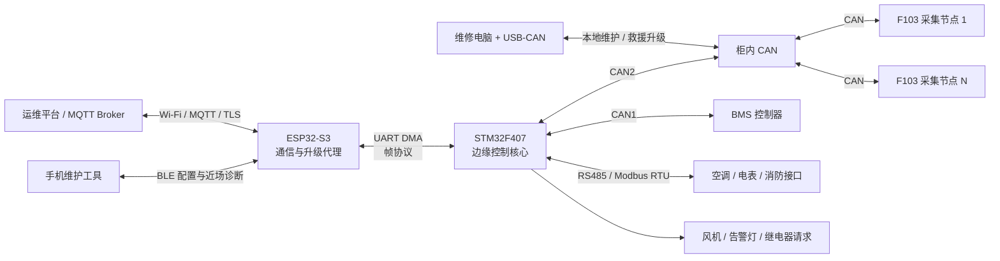

# 工业产品方案：储能电池柜安全监测与远程运维系统

> **状态说明：这是早期候选场景方案，目前已暂停，不再作为简历主项目总纲。**  
> 当前主项目改为与 BMS 解耦的精密实验环境运维系统，参见：[研究总纲与推进计划](精密实验环境运维系统_研究总纲与推进计划.md)。本文件保留用于比较不同场景的需求和升级策略。

> 产品代号：ESS Guardian（暂定）  
> 目标场景：工商业储能电池柜的环境监测、设备接入、边缘告警和远程固件运维  
> 原型硬件：STM32F407ZGT6 + ESP32-S3 N16R8 + STM32F103C8T6  
> 文档性质：产品与技术方案基线，不表示所有功能均已实机完成

## 1. 方案结论

本项目不再定位为单纯的“温湿度检测 Demo”，而是面向工商业储能电池柜的一套分布式安全监测与远程运维方案。系统接入柜内 BMS、环境传感节点、空调或风机、消防告警和门禁信号，在网络正常时向运维平台上报数据并接收维护请求；网络断开时仍由本地控制器完成采集、告警和有限的安全联动。

三块现有开发板按职责分工：

- **STM32F407ZGT6：边缘控制核心。** 负责实时总线、状态机、本地告警、控制输出和运行日志；
- **ESP32-S3 N16R8：通信与升级代理。** 负责 Wi-Fi、BLE、MQTT、云端连接、升级包下载和远程运维入口；
- **STM32F103C8T6：低成本现场采集节点。** 负责邻近传感器采集、输入输出和 CAN 通信，不为每个节点增加无线模块。

这不是一个替代 BMS 硬件保护链路或消防控制器的功能安全产品。原型系统定位为“监测、诊断、运维和上层联动”，关键过压、欠压、过流、短路和过温保护仍必须由 BMS AFE、独立保护电路及合规执行机构完成。

## 2. 为什么选择储能电池柜场景

这个场景能够把现有知识形成一条合理的产品链，而不是为了展示外设而堆砌功能：

1. BMS 天然使用 CAN，能够承接已有的 BQ76940/BMS 研究；
2. 空调、电表、消防和工业传感器常见 RS485/Modbus RTU；
3. 柜内需要温湿度、烟雾、VOC、门磁和辅助电源状态等分布式采集；
4. 边缘控制不能依赖云端持续在线，适合体现 MCU 实时控制和故障降级；
5. 远程运维需要 MQTT、日志、参数配置和固件升级；
6. 无线能力集中在每个柜子的网关上，比给每个 F103 节点增加 Wi-Fi/BLE 更符合成本、功耗和维护逻辑；
7. 设备数量多、生命周期长，升级兼容性、断电恢复、防降级和审计具有真实产品价值。

## 3. 系统架构



### 3.1 安全域与通信域分离

F407 保持柜内控制的权威状态，ESP32 不能直接控制接触器或绕过 F407 的安全状态机。云端命令只能表达“请求”，F407 根据当前电流、接触器、故障、温度、供电和维护授权决定是否执行。

因此，即使出现以下问题，系统仍保持本地基本能力：

- Wi-Fi 断开；
- MQTT Broker 不可达；
- ESP32 重启或正在 OTA；
- 云端命令延迟或重复；
- 手机维护工具离开现场。

### 3.2 数据流和控制流

```text
普通数据：传感器/F103/BMS → F407 聚合 → ESP32 → MQTT 平台
紧急告警：传感器/F103/BMS → F407 立即判定并本地输出 → 异步上报
远程命令：平台 → ESP32 校验会话 → F407 策略判断 → 执行/拒绝 → 结果回报
固件升级：平台/维修工具 → 升级代理 → 目标 Bootloader → 校验 → 激活/恢复
```

云端只参与运维和非实时管理，不能成为本地安全闭环的必要条件。

## 4. 三块开发板的产品职责

### 4.1 STM32F407ZGT6：边缘控制核心

建议承担：

- FreeRTOS 任务调度与模块生命周期管理；
- BMS CAN 数据接收、超时检测和信号解析；
- 现场节点 CAN 通信和节点在线管理；
- RS485/Modbus RTU 轮询；
- UART DMA 与 ESP32 交换数据；
- 本地状态机、分级告警和风机/继电器控制请求；
- 参数管理、事件日志、复位原因和故障快照；
- IWDG/WWDG、时钟自检、任务存活监控；
- 网络模块离线时的自治运行；
- 面向自身固件和下级节点的升级协调。

F407 的价值不是“外设更多”，而是把确定性控制从网络通信中隔离出来。以后即使把 ESP32 换成 4G、以太网或其他通信模块，F407 的核心业务仍可保留。

### 4.2 ESP32-S3 N16R8：通信与升级代理

建议承担：

- Wi-Fi Station、BLE 近场配置；
- MQTT 遥测、告警、命令和升级状态上报；
- 与服务器建立 TLS 连接；
- 下载 Manifest 和固件包；
- 保存或转发 F407/F103 的候选固件；
- 维护设备身份、版本清单和升级会话；
- 自身 A/B OTA、首次启动确认和自动回滚；
- 为实验提供故障注入和可观测日志。

ESP32 不进入关键实时控制路径。无线模块故障时，最坏结果应当是远程运维暂时不可用，而不是柜内保护和散热控制失效。

### 4.3 STM32F103C8T6：现场采集节点

建议承担：

- I²C/SPI/ADC/GPIO 传感器采集；
- 温湿度、烟雾/VOC、门磁、风机反馈等信号预处理；
- 中值滤波、限幅、迟滞和传感器断线诊断；
- 周期数据、变化数据和紧急告警的 CAN 上报；
- 本地输出的安全默认值；
- 小型 CAN IAP Bootloader 和升级恢复模式。

F103C8T6 的资源约束应当成为设计亮点，而不是被隐藏。它不运行 Wi-Fi、TLS 和复杂 MQTT，也不默认承诺双槽自动回滚。

## 5. 通信方案

### 5.1 F103/F407 与 BMS：CAN

建议将 CAN 分成两类逻辑业务：

- **实时业务报文：** 心跳、测量值、告警、控制状态；
- **维护业务报文：** 参数读取、诊断、日志和固件分块传输。

应用层应至少包含 Node ID、消息类型、滚动计数器、状态和必要的端到端 CRC。CAN 控制器自身的 CRC 能发现单帧传输错误，但不能单独发现旧报文重复、报文顺序错误、数据对象拼装错误或错误节点发送合法格式报文。

升级流量必须限速，并让位于高优先级心跳和安全报文。默认逐节点升级，不允许所有采集节点同时退出业务。

### 5.2 F407 与工业设备：RS485/Modbus RTU

F407 作为 Modbus 主站轮询空调、电表或环境变送器。软件需要处理：

- DMA 接收和空闲帧判定；
- 半双工方向控制；
- CRC16、地址和功能码校验；
- 超时、重试、离线和恢复；
- 不同设备寄存器表的适配；
- 轮询周期与总线占用率预算。

### 5.3 F407 与 ESP32：UART DMA 帧协议

原型优先使用 UART DMA，原因是硬件连接简单、容易抓取日志，也能学习 DMA、环形缓冲区和流式解析。协议建议包含：

```text
帧头 + 协议版本 + 消息类型 + 序号 + Payload 长度 + Payload + CRC
```

数据与控制使用明确的请求/响应和超时，不用串口打印文本充当正式通信协议。后续若吞吐量不足，可以保持上层消息不变，只把传输适配器替换为 SPI。

### 5.4 ESP32 与平台：MQTT

建议划分遥测、告警、状态、配置、升级请求和升级结果 Topic。控制 Topic 默认禁止 Retain，命令包含请求 ID、有效期和目标版本，设备回报明确的接受、拒绝、执行中和最终结果。

## 6. 产品功能边界

### 6.1 数据采集

- BMS：SOC、SOH、总压、电流、单体极值、温度极值和故障状态；
- 环境：温湿度、烟雾/VOC、柜门、积水或风机反馈；
- 设备：空调、电表、辅助电源和通信状态；
- 系统：复位原因、任务存活、总线错误、丢包、堆栈水位和固件版本。

### 6.2 本地告警和联动

告警应采用状态机，而不是单次采样值直接触发：

```text
正常 → 预警 → 告警 → 严重告警 → 恢复观察 → 正常
```

状态转换考虑阈值、迟滞、持续时间、传感器可信度和多源交叉验证。F407 可以请求提高风机转速、点亮告警灯或通知上级系统，但不替代 BMS 的硬件保护动作。

### 6.3 日志与诊断

至少记录：

- 启动时间、复位原因和固件版本；
- 告警进入、升级、恢复和确认；
- 节点上线/离线；
- CAN/RS485/MQTT 通信错误计数；
- 配置修改来源和结果；
- 升级目标、版本、阶段、错误码和最终结果。

日志使用环形存储和写入限频，避免高频故障耗尽 Flash 擦写寿命。

## 7. 分级固件升级方案

### 7.1 统一固件包

不同 MCU 使用相同思想的 Manifest：

```text
产品 ID、目标节点类型、硬件版本范围、固件版本、发布序号、
镜像长度、SHA-256、最低 Bootloader 版本、配置 Schema、数字签名
```

CRC 用于发现随机传输错误，SHA-256 用于确认内容一致，数字签名用于证明发布者身份，三者不能互相替代。

### 7.2 ESP32 自身升级

使用已经完成的 A/B 方案：

```text
Manifest → 兼容性/序号检查 → 下载备用槽 → SHA-256/镜像校验
→ 切换启动槽 → pending_verify → 健康确认或自动回滚
```

这是当前项目已经实机跑通的部分，也作为其他 MCU 升级状态机的可运行参考。

### 7.3 F407 升级

产品方案建议使用受保护 Bootloader、内部 Application 区和外部 SPI NOR 暂存区：

1. ESP32 下载升级包并完成第一层检查；
2. F407 自己再次校验目标、硬件版本、发布序号和签名；
3. 完整镜像先进入外部 Flash，校验通过后才进入安装阶段；
4. Bootloader 从暂存区复制到内部 Application；
5. 复制中断电时，Bootloader 根据冗余元数据继续复制或重新开始；
6. 新 App 自检后提交版本，失败则从黄金镜像恢复或停留在救援模式。

如果现有 F407 学习板没有可用外部 Flash，原型可以先让 ESP32 的 Flash 保存完整 F407 镜像并在复位后重新传输；这属于可恢复原型，不冒充产品级自动回滚。

### 7.4 F103C8T6 升级

F103C8T6 采用“小 Bootloader + 单 Application 槽 + CAN 恢复模式”：

1. F407 缓存完整 F103 固件；
2. F103 进入安全维护状态，Bootloader 擦除并顺序写入 Application；
3. 每个数据块带会话、序号、偏移和校验，支持 NACK 和重传；
4. 完整镜像校验通过后才设置 App Valid；
5. 断电或失败后停留在 Bootloader，由 F407 重新发送。

它能够避免永久变砖，但没有保存旧 App，因此是“可恢复升级”，不是真正的自动回滚。若产品明确要求 F103 节点无人值守自动回滚，应选择更大 Flash MCU、增加外部 Flash，或调整系统硬件，而不是宣称 C8T6 已实现双槽。

### 7.5 升级安全门控

进入升级前至少检查：

- 系统处于维护模式；
- 充放电和高压操作已经停止；
- 接触器处于产品定义的安全状态；
- 无火警、严重温度或绝缘故障；
- 辅助电源稳定并满足预计升级时长；
- 目标节点通信稳定；
- 固件与产品、硬件和 Bootloader 兼容；
- 升级请求已授权且未过期。

升级期间新的危险状态出现时，需要区分“可以安全取消的接收阶段”和“不能随意中断的内部 Flash 安装阶段”。不能只用一个布尔值表示整个升级过程。

### 7.6 系统升级顺序

建议按兼容矩阵编排：

1. 下载并检查所有目标镜像，不立即安装；
2. 逐个升级非关键 F103 节点并确认恢复上线；
3. 升级 F407，ESP32 保持在线并提供救援镜像；
4. F407 恢复并确认核心业务后，最后升级 ESP32；
5. 上报整次活动的节点版本表和最终结果。

任何一步失败都应停止后续节点升级，保留明确错误阶段，不能继续滚动扩大故障范围。

## 8. 工业产品必须考虑的问题

### 8.1 硬件可靠性

- CAN/RS485 收发器的浪涌、ESD、共模和隔离需求；
- 终端电阻、偏置、电缆长度和接地；
- 电源跌落、反接、看门狗和 Brownout；
- 输出上电默认态以及 MCU 失控时的硬件安全态；
- 量产烧录、SWD、BOOT 和救援接口；
- 传感器断线、短路、越界和漂移诊断。

开发板可以验证软件思想，但不能代表产品已经通过 EMC、安规、环境和可靠性认证。

### 8.2 软件可靠性

- 通信、业务、存储和硬件驱动分层；
- 所有外部输入有长度、范围、版本和状态校验；
- 配置和升级元数据采用版本、CRC、冗余与原子提交；
- 任务有超时、心跳和栈水位监控；
- 看门狗复位后保存原因并进入可解释的恢复路径；
- 网络回调只投递事件，不在回调中擦写 Flash 或执行长事务；
- 告警和控制命令具备幂等性，能处理重复、乱序和超时。

### 8.3 网络安全

- MQTT 使用 TLS 和设备身份；
- 固件使用离线数字签名，目标设备自己验签；
- 控制命令包含请求 ID、权限、时间窗和防重放信息；
- 生产调试口、默认密码和密钥注入有生命周期管理；
- 发布序号由不可随 App 任意回退的可信组件维护；
- 云端、网关和节点都有最小权限，不能因为网关可信就跳过节点校验。

当前 ESP32 HTTP + SHA-256 实验只证明传输和完整性状态机，不等同于量产安全 OTA。

## 9. 设计目标而非既成指标

以下内容可作为后续原型验收目标，未经测试前不能写成实测结论：

| 项目 | 建议设计目标 |
|---|---|
| F103 节点数量 | 先支持 4 个原型节点，协议预留 16 个地址 |
| 常规采集周期 | 1～5 秒可配置 |
| 本地严重告警处理 | 不等待云端，在一个控制周期内响应 |
| 节点离线检测 | 连续心跳超时后 3 秒内形成离线事件 |
| 网络中断 | F407 本地采集和告警继续运行 |
| 升级并发 | CAN 节点逐个升级，系统同一时刻只有一个安装事务 |
| 升级失败 | 保留阶段码、错误码、目标版本和恢复路径 |
| 参数更新 | 校验、持久化和应用作为一个可回滚事务 |
| 长稳测试 | 后续进行 24/72 小时运行、断网和重复复位测试 |

## 10. 实操、模拟和理论研究的内部证据分级

简历可以包含理论研究，但必须用准确动词，使技术边界经得住追问。

| 等级 | 含义 | 简历适用动词 |
|---|---|---|
| A：实机验证 | 真实开发板运行，有代码、日志和故障测试 | 实现、搭建、联调、验证 |
| B：台架/模拟验证 | 使用模拟报文、USB-CAN、故障注入或替代设备 | 搭建台架、模拟、验证策略 |
| C：设计研究 | 完成架构、状态机、资源预算和测试方案，尚未上板 | 设计、研究、评估、规划 |

### 10.1 当前已经达到 A 级的内容

- ESP32-S3 FreeRTOS 采样服务；
- AHT20 I²C 驱动、CRC、错误重试和数据快照；
- BLE GATT、Wi-Fi Station、MQTT 遥测和远程参数；
- NVS 配置持久化、异常记录恢复和 retained 命令防御；
- ESP32 A/B OTA、Manifest、发布序号、SHA-256；
- 新固件 pending verify、健康确认和故障自动回滚；
- 复位后有效版本和配置保持。

### 10.2 适合下一步做到 A/B 级的内容

- F407 与 USB-CAN 双向收发；
- F407 FreeRTOS、UART DMA 环形缓冲区和 ESP32 帧协议；
- F407 系统时钟、双时基自检和看门狗；
- F103/F407 CAN 节点协议；
- 使用 USB-CAN 或 PC 脚本模拟 BMS 周期数据和故障帧；
- F103 CAN IAP 的最小 Bootloader 与断点恢复；
- 如果模块具备，完成 RS485/Modbus RTU 台架。

### 10.3 现阶段保持 C 级的内容

- 真实储能柜多节点部署；
- 隔离 CAN/RS485 和产品 PCB；
- 数字签名、安全密钥注入和量产防回滚；
- F407 外部 Flash 黄金镜像恢复；
- 完整消防、空调和接触器联动；
- EMC、安规、功能安全和批量产测认证。

## 11. 简历定位建议

建议项目名称：

> **基于 STM32F407/ESP32-S3 的储能电池柜安全监测与远程运维系统**

一句话定位：

> 面向工商业储能电池柜，设计 F103 现场采集、F407 边缘控制和 ESP32 无线运维的三级架构，实现多协议数据采集、离线自治、远程配置以及具备完整性校验和失败恢复的分级固件升级。

简历描述应把实操与设计自然结合，而不是额外标注“理论”：

- 对已经完成的 ESP32 功能使用“实现并实机验证”；
- 对 USB-CAN 和后续台架使用“搭建并完成故障注入”；
- 对尚未上板的 F103/F407 产品机制使用“设计、评估、制定”；
- 面试时主动说明原型板与量产硬件的差异，并给出迁移条件。

面试官真正关心的不是是否购买了整套储能柜，而是能否解释：为什么这样分层、故障时系统怎样退化、资源不够时怎样取舍、升级中断后怎样恢复，以及哪些结论来自实机证据。

## 12. 后续推进顺序

当前先冻结产品边界，不立即扩写代码。后续建议按照以下顺序讨论和实施：

1. 完成 ESP32 的模拟安全门控、MQTT 升级管理和故障注入；
2. 盘点 F407 学习板实际具备的 CAN 收发器、RS485、以太网 PHY 和 SPI Flash；
3. 搭建 F407 + USB-CAN 最小台架，先跑通时钟、CAN 和错误状态；
4. 建立 ESP32 ↔ F407 的 UART DMA 帧协议；
5. 使用 PC/USB-CAN 模拟 BMS 数据和严重故障；
6. 引入 F103 节点，完成心跳、测量和告警上报；
7. 设计并验证 F103 CAN IAP 可恢复升级；
8. 最后根据现有模块决定是否加入 RS485/Modbus 和 Ethernet/lwIP。

相关深入设计参见：[第二阶段 BMS 视角固件升级与回滚设计方案](../第二阶段_BMS视角固件升级与回滚设计方案.md)。
