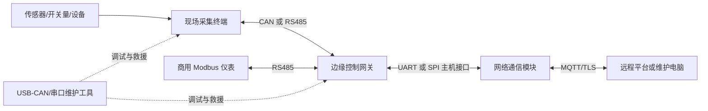
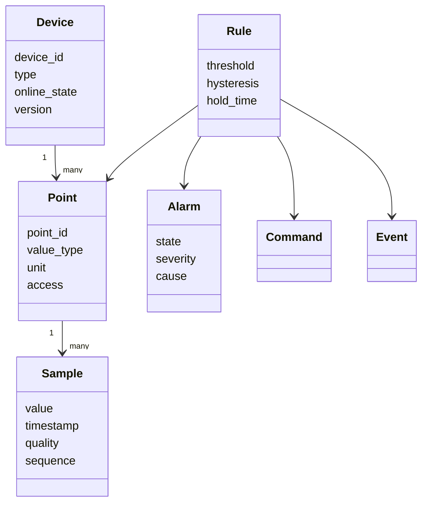

# 阶段一：产品需求与硬件选型

> 项目：无人值守精密实验环境智能管控与设备运维系统  
> 首选落地场景：光学暗室及同类精密实验空间  
> 文档状态：阶段一设计基线已完成，具体订货型号尚未冻结  
> 研究目标：先证明需求与资源预算，再讨论具体芯片，避免“手头有什么板就把什么写成产品”

## 1. 本阶段要回答的问题

1. 产品具体替谁解决什么问题，哪些功能不在范围内？
2. 哪些能力必须在断网时继续工作，哪些可以交给上位平台？
3. 为什么需要现场终端、边缘控制网关和网络通信模块这些逻辑角色？
4. 每个角色至少需要多少接口、Flash、SRAM、算力和升级空间？
5. F103、F407、ESP32-S3 是产品选择还是实验载体？还有哪些更合适的候选？
6. 怎样把成本、开发风险、供应和可维护性放进选型，而不是只比较主频？

本阶段的输出是可追溯的决策依据，不是立即画 PCB 或采购最终器件。

## 2. 产品定义

### 2.1 一句话定位

这是一套面向无人值守精密实验空间的分布式边缘管控系统：统一接入环境传感器和实验设备，在网络异常时仍能完成本地监测、告警与有限联动，并提供远程配置、诊断、日志和可靠升级能力。

### 2.2 主要用户

| 用户 | 关心的问题 | 系统提供的价值 |
|---|---|---|
| 实验人员 | 环境是否满足实验条件、异常是否及时提醒 | 当前状态、告警、实验前检查和历史趋势 |
| 设备/运维工程师 | 哪个节点、传感器或链路出了问题 | 设备清单、诊断信息、日志、远程参数和升级 |
| 实验室管理员 | 无人时是否安全、故障是否可追溯 | 本地自治、权限、事件记录和恢复流程 |
| 研发/生产人员 | 新设备如何接入、出厂如何验证 | 协议适配、工厂自检、接口测试和版本管理 |

### 2.3 典型业务场景

- 实验前确认温湿度、光照、门状态和关键设备在线状态满足条件；
- 实验中发现开门、异常光照、温度持续越界或设备离线，触发声光告警并按策略停止高风险设备；
- 网络中断时继续采集、判断和记录，恢复连接后补充状态和事件；
- 运维人员远程查看故障阶段、修改经过校验的参数、获取日志或发起受控升级；
- 新传感器或新通信协议接入时，仅新增驱动/协议适配，尽量不改告警业务规则。

### 2.4 非目标

第一版不承诺以下内容：

- 不开发 Linux/Qt 可视化主机、云平台和手机 App；
- 不替代消防、生命安全或具备强制认证要求的专业保护控制器；
- 不同时实现所有传感器、所有工业协议和所有联动设备；
- 不以电池节点的微安级待机为全系统硬指标，暗室控制器默认由市电或 24 V 工业电源供电；
- 不把“理论设计过”写成“已经量产或通过长期现场验证”。

## 3. 产品边界和逻辑角色



| 角色 | 必须负责 | 不应该负责 |
|---|---|---|
| 现场采集终端 | 采集、质量检查、局部输入输出、心跳、有线通信 | 云端连接、复杂 UI、全局策略 |
| 边缘控制网关 | 设备模型、全局状态机、告警/联动、离线日志、协议汇聚 | 把本地安全能力依赖于网络模块 |
| 网络通信模块 | Wi-Fi/BLE、MQTT/TLS、平台会话、网关升级包下载 | 在无线掉线后决定本地设备是否安全 |
| 维护工具/平台 | 配置、可视化、版本管理、升级编排、数据归档 | 取代设备端最后一道本地保护 |

逻辑角色不等于必须使用三块 MCU。小规模产品可以合并现场终端和网关；传感点分散、线缆长或需要隔离时再拆成多节点。先分清职责，后根据成本和可靠性决定物理合并。

## 4. 第一版需求基线

### 4.1 功能需求

| 编号 | 需求 | 优先级 | 第一轮验证方式 |
|---|---|---:|---|
| FR-01 | 采集温湿度、光照、门磁和至少一种设备运行状态 | P0 | ESP32 已验证温湿度；其余使用模拟量/开关量模拟 |
| FR-02 | 数据带时间戳、有效性、来源和质量标记，不用单个裸浮点数代表全部语义 | P0 | 单元测试/日志检查 |
| FR-03 | 支持阈值、迟滞、持续时间和恢复条件，抑制临界值反复告警 | P0 | 状态机故障注入 |
| FR-04 | 断网时仍能采集、告警、有限联动和记录关键事件 | P0 | 断开 Wi-Fi/MQTT 测试 |
| FR-05 | 支持 CAN 接入自研节点，支持 RS485/Modbus 接入常见仪表 | P0 | 分别完成一条最小台架链路 |
| FR-06 | 支持远程遥测、在线状态、配置下发和配置状态回读 | P0 | ESP32 MQTT 已部分验证 |
| FR-07 | 配置必须经过范围和一致性校验，持久化失败不能伪装成功 | P0 | NVS 已验证；后续补异常设计分析 |
| FR-08 | 记录启动、告警、配置、通信、升级和复位原因等事件 | P1 | 日志模型与环形存储实验 |
| FR-09 | 支持网关自身可靠升级，并可编排下级节点升级 | P1 | ESP32 A/B OTA 已验证；节点升级先设计后择机实操 |
| FR-10 | 支持自检、版本/设备清单、心跳和关键运行统计 | P1 | 启动日志、诊断消息和超时注入 |
| FR-11 | 支持工厂测试或维护模式，与正常运行模式隔离 | P2 | 方案和伪代码 |

### 4.2 非功能需求与设计目标

以下是第一版设计目标，不是已经测得的产品指标。

| 类别 | 第一版目标 | 设计含义 |
|---|---|---|
| 本地自治 | 网络模块重启或平台离线不阻断本地采集、告警和必要联动 | 业务状态和策略放在边缘 MCU，而不是 MQTT 回调里 |
| 规模 | 原型验证 1～2 个节点；架构支持 4～16 个现场节点 | 地址、数组和协议字段不能写死为单节点 |
| 采样 | 慢变量通常 1～5 s 可配置 | 不要求所有数据都以毫秒级采样 |
| 事件响应 | 门磁/异常光照等数字事件目标 200 ms 内进入业务处理 | 中断只采事件，判断和动作放在任务/状态机 |
| 告警确认 | 环境量在一个采样周期内参与判断，并支持持续时间 | “快速”不等于一次毛刺立即动作 |
| 节点离线 | 连续多个心跳丢失后判离线，具体次数可配置 | 兼顾偶发丢帧和故障发现时间 |
| 可维护性 | 错误信息至少包含模块、阶段、对象、错误码和时间 | 日志要回答“在哪里失败”，不只打印 `failed` |
| 可恢复升级 | 断电/传输失败后仍保留可启动路径和有线救援入口 | 升级槽、Bootloader 和救援接口纳入 Flash/引脚预算 |
| 安全 | 远程配置/升级需要身份、完整性和防重放设计 | 当前 HTTP 实验不是量产安全方案 |
| 连续运行 | 后续完成 24 h，再挑战 72 h 长稳与故障注入 | 先建立可测指标，不提前宣称达标 |

## 5. 轻量领域模型

引入领域模型的价值，是让“温度”不再分别以 Modbus 寄存器、CAN 两个字节和 MQTT JSON 字段的形态进入三套业务逻辑。



第一版对象约定：

| 对象 | 含义 | 示例 |
|---|---|---|
| `Device` | 可寻址、可诊断和可管理的设备 | 暗室节点 3、排风控制器 |
| `Point` | 设备上的测点或控制点定义 | 室温、门状态、风机使能 |
| `Sample` | 某次测量事实 | 24.5 ℃、时间戳、有效、序号 103 |
| `Quality` | 数据能否参与决策 | 有效、超时、越界、传感器故障、陈旧 |
| `Rule/Policy` | 从事实到决策的规则 | 温度 > 30 ℃ 持续 10 s 告警 |
| `Alarm` | 有生命周期的异常状态 | 正常、待确认、活动、已确认、恢复 |
| `Command` | 希望外部执行的动作 | 开启排风、停止设备、请求重采样 |
| `Event` | 已经发生的事实 | 门已打开、节点离线、升级失败 |

领域函数只接收当前状态和事件，返回新状态、命令和新事件；它不直接调用 GPIO、CAN 或 MQTT。服务层接收这些输出，再把 `Command` 交给相应端口执行。这样既能在 PC 上测试状态机，也能让 F407 和 ESP32 复用相同思路。

## 6. 初步接口与资源预算

### 6.1 现场采集终端

| 资源 | 初步预算 | 原因 |
|---|---:|---|
| CAN | 1 路 | 节点总线、事件和诊断；需要外部收发器 |
| RS485/UART | 0～1 路 | 某些终端可能直接接 Modbus 传感器；不是每个节点都必须装 |
| I²C | 1～2 路 | 环境传感器、EEPROM/RTC；总线故障要可恢复 |
| SPI | 1 路 | 可选外部 Flash 或高速传感器 |
| 调试/救援 UART | 1 路 | 日志、产测或 Bootloader 救援 |
| GPIO/EXTI | 12～20 个 | 门磁、告警、继电器、地址/模式和预留 |
| ADC | 4 路以上 | 模拟传感器、电源和板级诊断 |
| DMA/定时器/看门狗 | 必须 | 通信、周期调度、健康监测 |
| Flash | 建议从 128～256 KB 起评估 | 应用、Bootloader、配置、诊断和增长余量；双镜像需额外内部或外部存储 |
| SRAM | 建议 32 KB 起，优选 64 KB 以上 | RTOS 栈、队列、协议缓冲、升级和诊断留余量 |

### 6.2 边缘控制网关

| 资源 | 初步预算 | 原因 |
|---|---:|---|
| CAN | 2 路优选，1 路最低 | 现场节点与维护/扩展总线隔离；最终按成本裁剪 |
| UART/USART | 4 路左右 | RS485、网络模块、调试和扩展设备 |
| Ethernet MAC | 产品变体可选 | 固定场所优先有线网络；仍需外部 PHY 与磁性器件 |
| SPI | 2 路左右 | 外部日志 Flash、显示/扩展或网络接口 |
| I²C | 1～2 路 | RTC、安全器件或板级监测 |
| ADC/PWM/GPIO | 按引脚表核算 | 本地诊断和有限联动 |
| Flash | 512 KB 最低评估，1 MB 更稳妥 | RTOS、多协议、诊断、升级与增长余量 |
| SRAM | 128 KB 级优先 | 多任务栈、协议队列、日志、网络缓冲和升级分块 |
| 外部非易失存储 | 建议预留 SPI NOR | 离线日志、升级暂存、故障快照，减少内部 Flash 磨损 |

### 6.3 网络通信模块

| 资源 | 初步预算 | 原因 |
|---|---:|---|
| 无线 | 2.4 GHz Wi-Fi + BLE | Wi-Fi 远程通信，BLE 用于近场配网/维护而非核心控制 |
| 主机接口 | UART 必须，SPI 可选 | 与边缘 MCU 分离，协议可观测、可重启 |
| Flash | 建议 8 MB 起 | TLS、MQTT、A/B OTA、证书、日志和后续增长 |
| PSRAM | 非必需 | 普通 MQTT 网关不应因开发板有 8 MB PSRAM 就强制依赖 |
| 安全能力 | 安全启动、Flash 加密、硬件密码能力 | 建立可信启动和升级基础 |
| 天线 | PCB 天线/外接天线作为不同产品变体 | 金属柜或复杂安装环境需实际射频测试 |

这些数值是需求预算，不是芯片已用量。下一阶段的软件任务表和静态内存估算完成后，还要反向校核。

## 7. 候选器件初步比较

### 7.1 现场终端 MCU

| 候选 | 已知能力 | 初步判断 |
|---|---|---|
| STM32F103C8T6 | Cortex-M3 72 MHz、64 KB Flash，系列最高 20 KB SRAM，带 CAN、USB、I²C/SPI/USART | 手头有板、生态熟，适合最小 CAN/RTOS 实验；对日志、多协议和可靠升级余量偏紧，不宜不经预算直接定为量产型号 |
| STM32F103CB 或同系列更大 Flash 型号 | 保留熟悉架构并增加程序空间，但 SRAM 仍紧张 | 可降低迁移成本，但不能只靠增加 Flash 解决任务栈和缓冲区问题 |
| STM32G0B1 系列 | Cortex-M0+ 64 MHz，系列可到 512 KB Flash、144 KB SRAM，最多 6 USART、3 I²C、3 SPI、2 路 FDCAN、USB | 更像面向成本敏感新设计的候选；需按封装、实际 Flash 档位、引脚复用和经典 CAN 兼容性进一步筛具体料号 |

阶段结论：F103C8 保留为教学和台架节点；产品现场终端优先比较“更大容量 F103 低迁移方案”和“G0B1 等现代成本型 MCU 方案”。本轮不武断指定最终料号。

### 7.2 边缘控制网关 MCU

| 候选 | 已知能力 | 初步判断 |
|---|---|---|
| STM32F407ZGT6 | Cortex-M4F 168 MHz、1 MB Flash、系列最高 192 KB SRAM、双 CAN、Ethernet MAC，LQFP144 | 手头学习板可充分做网关、CAN、DMA 和时钟实验；量产时引脚/PCB 面积可能过剩 |
| STM32F407VGT6 | 与 F407ZG 同级核心和 1 MB Flash，LQFP100，含双 CAN 和 Ethernet MAC | 若 100 引脚能满足预算，它比直接照搬 144 引脚型号更接近成本/面积折中；仍需核对完整复用冲突 |
| 更新一代/国产同级 MCU | 可在成本、供货、安全或资源方面优化 | 必须建立同一张接口和内存矩阵后再比较，不能只凭“国产更便宜”或“新型号更好”下结论 |

阶段结论：F407ZGT6 是很好的原型载体；产品基线先以 F407VG 级资源作为参考上限，再用后续资源测算判断能否继续下探。

### 7.3 网络通信模块

| 候选 | 已知能力 | 初步判断 |
|---|---|---|
| ESP32-S3 N16R8 | 双核、丰富 GPIO、USB、16 MB Flash、8 MB PSRAM（当前板） | 开发和故障注入余量大，当前 OTA/网络实验继续使用；普通通信模块可能资源过剩 |
| ESP32-C3-WROOM-02/02U | 单核 RISC-V 160 MHz、400 KB SRAM、Wi-Fi + BLE 5、模块 Flash 可到 16 MB、15 GPIO，支持 PCB 或外接天线版本 | 若职责限定为 MQTT/TLS、配网、下载和主机通信，更接近量产成本方向；必须核对具体订货型号、生命周期、Flash 容量和主机接口数量 |

阶段结论：当前实操继续使用 S3；产品优先评估 C3 模块，只有 USB、更多 GPIO、PSRAM或更复杂边缘应用确有需求时再保留 S3。

## 8. 成本不是只看 MCU 单价

选型成本至少包括：

```text
器件采购
+ 外部 PHY/收发器/存储/晶振/电源
+ PCB 面积与层数
+ 认证和天线整改
+ 开发迁移与调试工时
+ 供应和替代风险
+ 生产测试和售后救援成本
= 生命周期总成本
```

因此本阶段只做相对判断：

- F103C8 的芯片和学习成本低，但资源紧可能提高升级、诊断和维护成本；
- F407ZG 功能充足，但 144 引脚和未使用外设会增加面积和 BOM；
- F407VG 可能在保留软件兼容性的同时减少封装成本；
- C3 模块可能减少无线部分成本和复杂度，但不能仅凭参数表断言一定低于 S3，最终要以同时间、同采购数量的授权渠道报价比较；
- 隔离 CAN/RS485、工业电源、保护、端子和连接器可能比 MCU 差价更影响整板成本，不能为了省几元 MCU 破坏可靠性。

## 9. 当前硬件方案基线

第一版先采用“两级控制 + 可选分布节点”：

1. 边缘 MCU 保存权威设备状态、告警规则和本地联动，网络模块不是安全控制核心；
2. ESP32 负责 Wi-Fi/BLE/MQTT/TLS 和远程包下载，通过受控主机协议与边缘 MCU 交换数据；
3. 传感器集中时可直接接网关，物理分散或环境恶劣时再增加 CAN/RS485 现场终端；
4. 网关预留 CAN、RS485、SPI NOR、RTC/板级诊断和有线救援接口；
5. 当前三块板分别验证 F103 资源受限节点、F407 网关和 ESP32 网络/OTA，不代表成品必须堆叠三块开发板。

## 10. 仍需澄清和验证的风险

| 风险/问题 | 为什么重要 | 后续动作 |
|---|---|---|
| 暗室真实传感点数量与线缆距离未知 | 决定集中/分布、CAN/RS485 数量和隔离 | 做一份 1 房间/多房间点位假设并评审 |
| 联动设备和失效安全状态未冻结 | 决定继电器、PWM、上电默认值和安全等级 | 建立执行器清单与“断电/断线时状态”表 |
| Ethernet 是否每台必需 | 影响 MCU、PHY、连接器、PCB 和成本 | 定义基础版与增强版，或由部署条件选择 |
| F407 是否资源过剩 | 只看当前板无法回答量产成本 | 完成任务/栈/队列/缓冲和 CPU 最坏估算 |
| 现场节点升级存储方案未定 | 内部双槽可能超过小 MCU 容量 | 比较单槽可恢复、外部暂存和 A/B 三种方案 |
| 无线模块生命周期和射频环境 | 金属暗室/机柜可能显著衰减 | 核对订货状态并做 PCB/外接天线现场测试 |
| 安全方案尚未闭环 | HTTP + SHA-256 只能检完整性，不能证明发布者身份 | 后续设计 HTTPS、签名、密钥和防降级策略 |

## 11. 第一版点位基线

这张表是用于选型和架构设计的 `V0.1` 基线，不代表已经采购和接入全部传感器。后续如果场景变化，应修改点位表并重新检查接口、任务和内存，而不是在代码里临时增加全局变量。

### 11.1 环境与安全输入：16 个逻辑点

| 点位组 | 数量 | 来源候选 | 周期/触发 | 数据失效时的处理 |
|---|---:|---|---|---|
| 四位置温度 `TEMP_01..04` | 4 | 数字温湿度传感器或 Modbus 仪表 | 2 s | 标为无效，保留最后有效值但禁止继续当成新数据决策 |
| 四位置湿度 `HUM_01..04` | 4 | 与温度共用物理传感器 | 2 s | 同上，并记录连续失败次数 |
| 工作区/入口光照 `LIGHT_01..02` | 2 | 模拟或数字光照传感器 | 200 ms～1 s | 实验模式中失效按风险策略处理，不默认解释为“黑暗” |
| VOC、CO₂ | 2 | SPI/I²C 传感器或 Modbus 变送器 | 5～10 s | 降级并提示维护，不直接伪造为 0 |
| 主门、维护门状态 | 2 | 隔离数字输入/门磁 | 边沿事件 + 周期校验 | 断线与开门尽量使用不同电气状态或诊断策略 |
| 漏水报警输入 | 1 | 漏水控制器干接点 | 边沿事件 | 按外部报警处理并记录来源 |
| 消防/烟感联动输入 | 1 | 合规消防控制器干接点 | 边沿事件 | 本系统只采集联动信号，不替代消防控制器 |

### 11.2 设备状态输入：8 个逻辑点

| 点位组 | 数量 | 示例 |
|---|---:|---|
| 排风运行/故障 | 2 | 接触器辅助触点、变频器或 Modbus 状态 |
| 空调运行/故障 | 2 | 干接点或设备通信状态 |
| 实验设备就绪/运行/故障 | 3 | 设备接口或隔离开关量 |
| UPS/供电告警 | 1 | UPS 干接点或 Modbus 告警摘要 |

### 11.3 受控输出：4 个逻辑点

| 输出 | 默认安全状态 | 限制 |
|---|---|---|
| 声光告警 | 复位后关闭，确认故障后允许开启 | 输出失效不能影响原始告警记录 |
| 排风使能 | 根据工艺风险确定；当前默认不自动强制关闭 | 需要反馈点确认命令是否真正执行 |
| 暗室照明禁止/许可 | 上电默认由硬件原回路控制 | 软件只能提供许可或联锁，不直接取代必要硬件保护 |
| 实验设备运行许可 | 上电默认禁止自动启动 | 必须同时满足本地条件、模式和人工授权 |

### 11.4 规模结论

- 第一版包含 24 个只读输入点和 4 个控制点；
- 四组温湿度虽然是 8 个逻辑点，但可能只占用 4 个物理传感器地址；
- 网关架构按 4～16 个现场节点、每节点最多 32 个点设计，第一轮台架只验证 1～2 个节点；
- 原始高频数据不全部长期保存，事件、统计量和关键故障快照采用不同保留策略；
- 告警规则引用 `point_id`，协议地址只存在于设备映射配置中。

## 12. F407VG 网关引脚复用预评审

### 12.1 评审假设

- 候选器件：`STM32F407VGT6`，LQFP100；
- Ethernet 使用 RMII，而不是占用更多引脚的 MII；
- 调试仅保留 SWD，不启用完整 JTAG，从而释放部分调试复用引脚；
- SPI NOR、双 CAN、一路 RS485、ESP32 主机串口和调试串口同时存在；
- 这是产品候选引脚方案，不等于当前 F407ZGT6 学习板的实际接线。

### 12.2 无冲突的第一版分配

| 功能 | 外设 | 引脚 | 复用 | 说明 |
|---|---|---|---|---|
| RMII 时钟/管理 | ETH | `PA1 REF_CLK`、`PA2 MDIO`、`PC1 MDC` | AF11 | PHY 还需要独立复位和中断 GPIO |
| RMII 接收 | ETH | `PA7 CRS_DV`、`PC4 RXD0`、`PC5 RXD1` | AF11 | RMII 共使用 9 根 MAC 信号 |
| RMII 发送 | ETH | `PB11 TX_EN`、`PB12 TXD0`、`PB13 TXD1` | AF11 | 因此不能再使用 PB12/PB13 的 CAN2 复用 |
| PHY 控制 | GPIO/EXTI | `PE2 RESET`、`PA0 INT` | GPIO | 中断极性和上电时序由具体 PHY 决定 |
| 现场 CAN | CAN1 | `PD0 RX`、`PD1 TX` | AF9 | 外接隔离或非隔离 CAN 收发器 |
| 维护/扩展 CAN | CAN2 | `PB5 RX`、`PB6 TX` | AF9 | 避开与 RMII 冲突的 PB12/PB13 方案 |
| CAN 收发器模式 | GPIO | `PE0 STB1`、`PE1 STB2` | GPIO | 上电默认进入受控状态 |
| RS485 | USART3 | `PD8 TX`、`PD9 RX`、`PD10 DE` | AF7 + GPIO | DE 由 GPIO 或定时精确控制；外接收发器和终端电阻 |
| ESP32 主机链路 | USART6 | `PC6 TX`、`PC7 RX` | AF8 | `PE4 READY`、`PE5 RESET` 作为旁带信号 |
| 外部 SPI NOR | SPI3 | `PC10 SCK`、`PC11 MISO`、`PC12 MOSI` | AF6 | `PE3 CS`；与 SDIO 复用冲突，因此当前不规划 SD 卡 |
| 板级 I²C | I2C1 | `PB8 SCL`、`PB9 SDA` | AF4 | 可接 RTC/安全器件/板级监测；CAN1 已放到 PD0/PD1 |
| 调试串口 | USART1 | `PA9 TX`、`PA10 RX` | AF7 | 避开被 Ethernet 占用的 USART2/PA2 |
| 在线调试 | SWD | `PA13 SWDIO`、`PA14 SWCLK`、`NRST` | AF0 | 保留量产测试点和救援能力 |
| 主时钟 | HSE | `PH0 OSC_IN`、`PH1 OSC_OUT` | 专用 | 晶振值在时钟树阶段确定 |
| RTC 低速时钟 | LSE | `PC14`、`PC15` | 专用 | 若成本裁剪 LSE，需要说明 RTC 精度变化 |
| 模拟诊断 | ADC | `PC0`、`PC2`、`PC3` | 模拟 | 电源、板温或模拟量预留，前端需保护与量程设计 |
| 四路受控输出 | TIM4/GPIO | `PD12..PD15` | AF2/GPIO | 可作为普通输出或 PWM；必须设计上电默认电平 |
| 八路数字输入 | GPIO/EXTI | `PE7..PE14` | GPIO | 最终根据隔离、电平和 EXTI 冲突调整 |

### 12.3 预评审结论

`STM32F407VGT6/LQFP100` 在启用 RMII、双 CAN、RS485、ESP32 UART、SPI NOR、I²C、调试串口、SWD 和基础 I/O 的条件下存在一组可行的无引脚重叠方案，因此没有必要仅为当前功能固定使用 LQFP144 的 F407ZG。

但这还不是可直接投板的原理图，后续必须继续检查：

1. CubeMX 外设和 DMA Stream 冲突；
2. RMII 50 MHz 时钟来源、PHY 型号、时序和 PCB 走线；
3. CAN/RS485 隔离、电源域、终端和浪涌/ESD；
4. 启动采样脚、上电默认电平、5 V 容忍与模拟引脚限制；
5. 当前 F407ZGT6 学习板已经占用的 LED、按键、外部存储和排针资源。

特别要区分两类冲突：引脚复用冲突发生在芯片管脚层，DMA Stream 冲突发生在数据搬运资源层；引脚表无冲突并不代表 CubeMX 配置必然无冲突。

## 13. Flash 与 SRAM 初步模型

### 13.1 为什么不能只看“总容量”

Flash 需要同时容纳 Bootloader、应用、升级镜像、配置和元数据；SRAM 需要同时容纳全局数据、任务栈、队列、网络与 DMA 缓冲和堆。除了总量，还必须考虑：

- Flash 擦除扇区大小和边界；
- 代码增长余量以及 Debug/Release 差异；
- DMA 能否访问某块 RAM；
- 峰值而不是平均缓冲区占用；
- 栈高水位、堆碎片和异常路径；
- 掉电原子性与 Flash 擦写寿命。

### 13.2 F407 网关 Flash 方案

F407VG 的 1 MiB 内部 Flash 扇区并不等大：前四个扇区各 16 KiB，随后一个 64 KiB 扇区，其余为 128 KiB 扇区。这会直接约束升级分区，而不是简单把 1 MiB 除以二。

#### 方案 A：片内双应用槽

| 区域 | 扇区 | 容量 | 用途 |
|---|---|---:|---|
| Bootloader | 0～3 | 64 KiB | 启动、镜像校验、槽位选择和救援 |
| 元数据/低频配置 | 4 | 64 KiB | 双副本状态、版本和升级事务；不存高频日志 |
| App A | 5～7 | 384 KiB | 当前或候选应用 |
| App B | 8～10 | 384 KiB | 另一应用槽 |
| 诊断/预留 | 11 | 128 KiB | 故障快照、工厂数据或后续调整 |

优点是回滚逻辑直观；缺点是单个 App 的物理上限只有 384 KiB，工程上还应再留约 15%～20% 增长余量，因此目标链接大小最好控制在约 300～320 KiB。

#### 方案 B：片外暂存 + 片内单应用

| 区域 | 容量建议 | 用途 |
|---|---:|---|
| Bootloader | 64 KiB | 校验并从 SPI NOR 恢复/安装镜像 |
| 元数据/配置 | 64 KiB | 事务状态和低频配置 |
| 主应用 | 最多约 768 KiB | 更完整的网关应用 |
| 片内恢复/预留 | 128 KiB | 恢复信息或后续安全需求 |
| 外部 SPI NOR | 8 MiB 起评估 | 新旧镜像、离线日志和故障快照 |

该方案允许更大的应用，但 Bootloader 必须拥有稳定的 SPI NOR 驱动、断电续装和镜像校验；否则外部 Flash 只是“多了容量”，并没有带来可靠恢复。

当前决策门槛：如果链接后的完整网关应用能长期控制在 320 KiB 左右，优先片内 A/B；如果引入 Ethernet/lwIP、文件系统和诊断后明显超过该值，则选择外部暂存恢复。尚未编译真实 F407 工程前，不宣称已经选择最终升级布局。

### 13.3 F407 网关 SRAM 预算

F407 的 192 KiB SRAM 不是一整块等价内存。其中 64 KiB CCM 只供 CPU 访问，不能放 Ethernet 或外设 DMA 缓冲。第一版预算如下：

#### DMA 可访问 SRAM1/SRAM2：128 KiB

| 用途 | 预算 |
|---|---:|
| `.data/.bss`、驱动上下文和设备表 | 16 KiB |
| Ethernet/lwIP 描述符、PBUF 与协议缓冲 | 32 KiB |
| CAN/UART/SPI DMA 环形缓冲 | 16 KiB |
| 队列、事件、软件定时器和 RTOS 控制块 | 12 KiB |
| 通用受控堆 | 24 KiB |
| 故障快照与配置工作区 | 4 KiB |
| 未分配安全余量 | 24 KiB |
| **合计** | **128 KiB** |

#### CPU 专用 CCM：64 KiB

| 用途 | 预算 |
|---|---:|
| 静态任务栈及高水位余量 | 40 KiB |
| 领域状态、规则和统计数据 | 8 KiB |
| 算法临时区/格式化工作区 | 4 KiB |
| 栈溢出保护与增长余量 | 12 KiB |
| **合计** | **64 KiB** |

这只是设计预算。实现时要通过链接 `map` 文件、`size` 工具、FreeRTOS 栈高水位、堆最小剩余值和压力测试获得实测值。任何 DMA 缓冲都必须放在 DMA 可访问 SRAM，并满足对齐及缓存/总线要求。

### 13.4 现场节点的容量门槛

| 平台 | 初步布局判断 | 结论 |
|---|---|---|
| F103C8：64 KiB Flash / 20 KiB SRAM 级 | Bootloader 约 12～16 KiB 后，应用和配置空间非常有限；RTOS 栈、CAN/串口缓冲也会快速消耗 SRAM | 适合最小节点和资源约束实验，不承诺片内 A/B |
| F103CB：128 KiB Flash / 20 KiB SRAM 级 | Flash 压力缓解，但 SRAM 仍限制任务数、诊断和升级缓冲 | 可作为低迁移候选，仍需外部暂存或单槽可恢复方案 |
| G0B1 具体大容量型号 | 目标门槛至少 256 KiB Flash、64 KiB SRAM，再按封装和 FDCAN 筛选 | 更适合新产品节点，但必须核对具体型号而非引用系列最大值 |

节点选型不以“能编译进去”为通过标准。冻结型号前至少保留 20% Flash 增长余量和约 25% 峰值 SRAM 余量，并明确升级失败后的有线恢复路径。

## 14. 阶段一评审结果

- [x] 冻结 `V0.1` 点位基线：24 个输入点、4 个控制点、4～16 个节点的架构上限；
- [x] 找到 F407VG/LQFP100 同时容纳 RMII、双 CAN、RS485、ESP32 UART、SPI NOR、I²C 和调试接口的无重叠引脚方案；
- [x] 建立 F407 Flash 两种升级布局、DMA/CCM 分区预算及现场节点容量门槛；
- [ ] 在真实 F407 工程中用 CubeMX 验证 DMA Stream、时钟和现有学习板占用；
- [ ] 用实际 `map`、栈高水位和压力测试替换设计预算；
- [ ] 根据同一采购数量和日期补充器件及外围 BOM 报价。

前三项足以结束“纸面需求与初选”并进入第二阶段软件架构；后三项属于实现过程中的回填证据，不阻塞架构研究。当前推荐方向是：F407VG 级网关 + ESP32-C3 级网络模块 + 按布线需求选配现代 CAN 现场节点。最终订货型号仍保持未冻结。

## 15. 官方资料入口

以下资料用于核对参数，价格和供货仍需在实际选型时按日期重新查询：

- [STM32F103C8 产品页](https://www.st.com/en/microcontrollers-microprocessors/stm32f103c8.html)
- [STM32F407ZG 产品页](https://www.st.com/en/microcontrollers-microprocessors/stm32f407zg.html)
- [STM32F407VG 产品页](https://www.st.com/en/microcontrollers-microprocessors/stm32f407vg.html)
- [STM32F405/F407 数据手册（LQFP100 引脚与复用表）](https://www.st.com/resource/en/datasheet/stm32f407vg.pdf)
- [STM32F4 参考手册 RM0090（存储、DMA、Ethernet 等）](https://www.st.com/resource/en/reference_manual/dm00031020.pdf)
- [STM32G0B1VB 产品页（用于查看 G0B1 系列能力）](https://www.st.com/en/microcontrollers-microprocessors/stm32g0b1vb.html)
- [STM32G0 系列介绍](https://www.st.com/en/microcontrollers-microprocessors/stm32g0-series.html)
- [ESP32-C3-WROOM-02/02U 数据手册](https://documentation.espressif.com/esp32-c3-wroom-02_datasheet_en.html)
- [ESP32-S3 数据手册](https://documentation.espressif.com/esp32-s3_datasheet_en.pdf)

> 注意：系列最大参数不等于某个具体订货型号的参数。后续冻结型号时必须再次核对具体后缀、封装、温度等级、Flash、引脚复用、勘误和生命周期状态。
