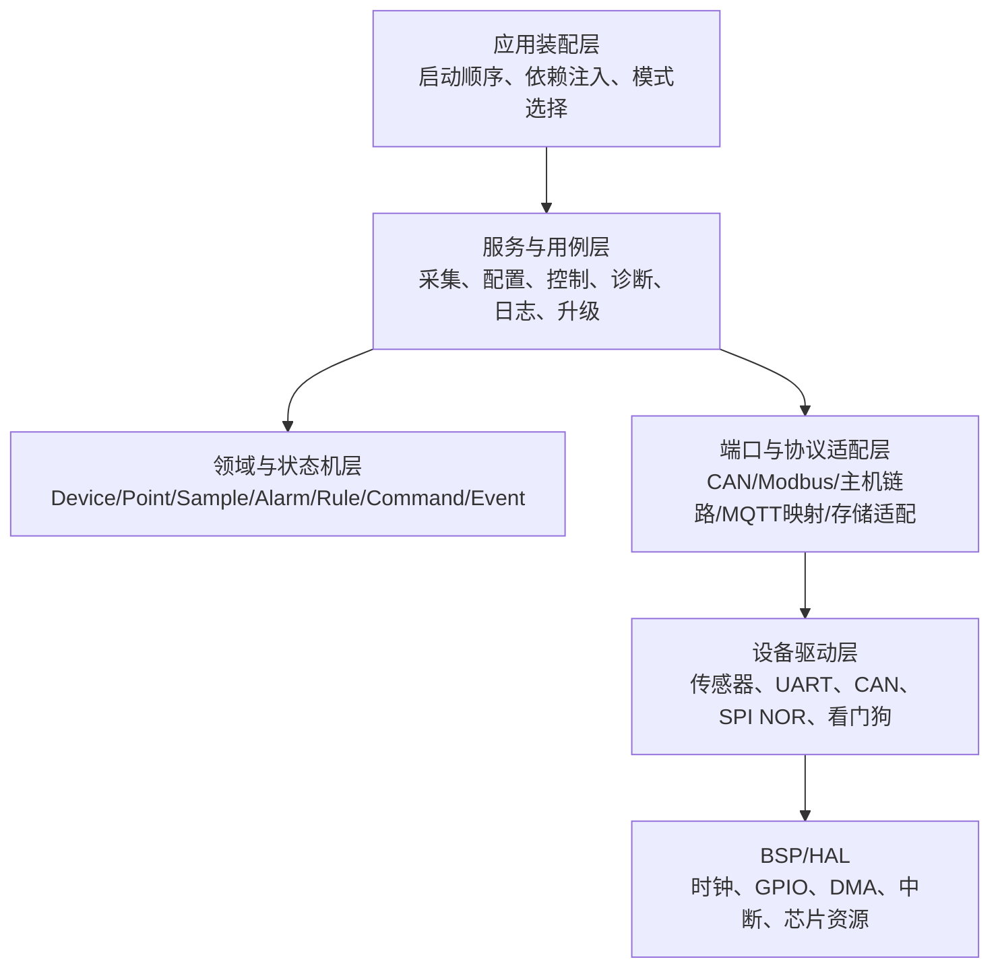
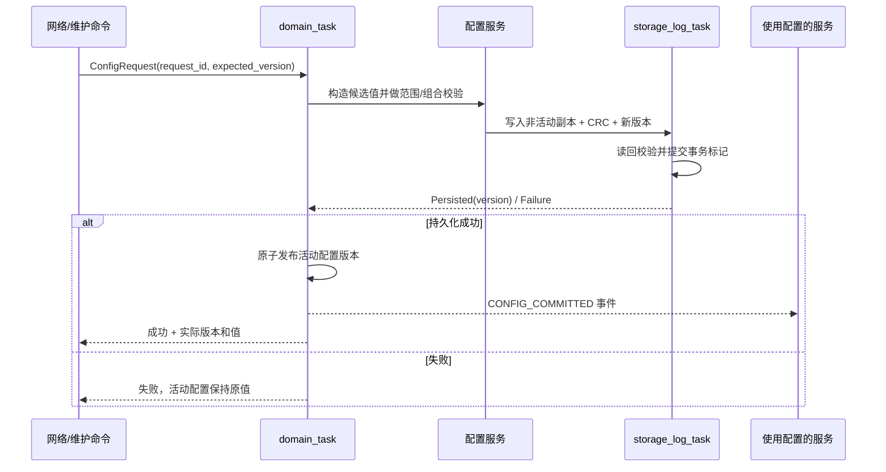
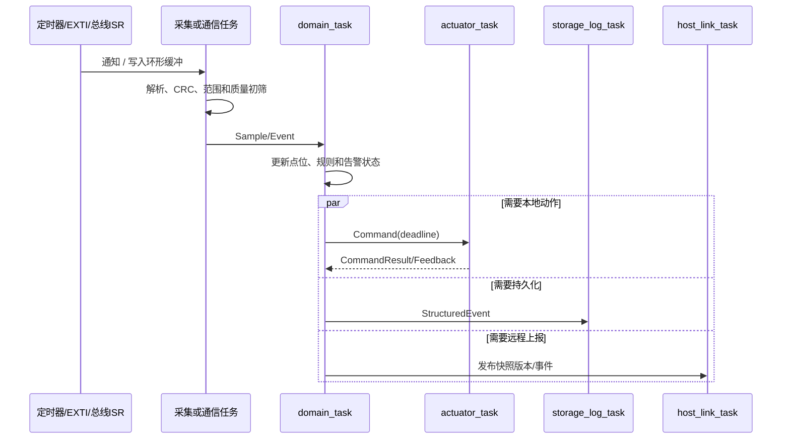

# 阶段二：软件架构、任务与 IPC 设计

> 项目：无人值守精密实验环境智能管控与设备运维系统  
> 当前对象：F407 级边缘网关 + ESP32 级网络模块 + 可选现场节点  
> 文档性质：核心软件架构设计，不等于已经完成全部代码和实机验证  
> 前置输入：[阶段一：产品需求与硬件选型](阶段1_产品需求与硬件选型.md)

## 1. 本阶段真正要解决的问题

软件架构不能只回答“分几层”，还必须回答：

1. 每份可变数据由谁拥有，哪些模块只有读取权？
2. 中断、驱动回调、任务和业务状态机之间如何传递信息？
3. 哪些功能需要独立任务，哪些只是被任务调用的普通模块？
4. 队列满、任务卡死、传感器失效和网络掉线时系统如何退化？
5. F407 和 ESP32 谁拥有最终控制权，网络模块失效后系统还能做什么？
6. 任务优先级、栈、队列和缓冲区如何对应第一阶段的 SRAM 预算？
7. 怎样让业务逻辑可以在 PC 上测试，而不依赖 HAL、FreeRTOS 和真实传感器？

如果这些问题没有答案，层次再漂亮也只是目录分类，而不是可实现、可调试的架构。

## 2. 架构总原则

### 2.1 采用轻量六层架构



编译依赖遵循“外层依赖内层抽象”：

- 领域层不包含 FreeRTOS、HAL、CAN、MQTT 或某颗传感器头文件；
- 服务层使用领域对象和 `port` 接口，不知道接口背后是 F407、ESP32 还是真实 Flash；
- 协议适配器负责在外部报文和内部领域对象之间转换；
- 驱动只表达硬件能力和错误，不判断“温度超限是否应该开排风”；
- 应用装配层创建实例、注入接口并决定启动顺序，本身不承载传感器协议和告警算法。

### 2.2 模块不等于任务

创建任务的合理理由只有几类：

- 有独立实时周期；
- 会在外设、队列或存储上阻塞；
- 必须与其他功能隔离故障和执行时间；
- 是明确的单一数据拥有者；
- 需要在不同优先级运行。

一个普通解析器、状态机或校验模块通常只是函数库，不应该为了“看起来模块化”单独创建任务。任务越多，栈占用、上下文切换、互斥锁和时序组合越多。

### 2.3 单一写者优先

对关键状态优先采用“一个任务写，其他模块通过消息请求或读取快照”的方式，避免多个任务直接拿同一把大锁修改共享结构。

### 2.4 消息有界、失败可见

所有队列和缓冲区必须有固定上限、超时和溢出策略。禁止无限等待、无限增长以及“发送失败但继续假装成功”。

### 2.5 启动后尽量静态分配

任务、栈、队列、事件池和主要缓冲区在启动阶段一次性分配。正常运行阶段避免频繁 `malloc/free`，降低堆碎片、分配失败和故障复现难度。

## 3. 编译依赖与运行时数据流要分开理解

依赖方向和数据流不是一回事。

```text
编译依赖：协议适配器 → 领域定义/端口定义
运行数据：CAN ISR → CAN任务 → 协议适配器 → 领域任务 → 执行器任务
```

领域层虽然位于依赖中心，但运行时数据通常从硬件流向领域，再由领域输出命令流回硬件。面试时如果只说“上层调用下层”，很难解释异步事件，因此应同时说明这两个方向。

## 4. 核心领域模型与边界

### 4.1 领域对象

| 对象 | 关键字段 | 所解决的问题 |
|---|---|---|
| `Device` | ID、类型、版本、在线状态、最后心跳 | 系统管理的对象是谁 |
| `PointDefinition` | 点位 ID、类型、单位、权限、来源映射 | 一个值的业务含义是什么 |
| `Sample` | 值、单调时间、UTC 时间、序号、质量 | 这次测量是否可信、是否新鲜 |
| `Quality` | 有效、超时、越界、陈旧、传感器故障 | 坏数据不能伪装为 0 或覆盖有效事实 |
| `Rule/Policy` | 条件、迟滞、持续时间、模式、动作 | 怎样从事实产生决策 |
| `Alarm` | 状态、等级、开始/确认/恢复时间、原因 | 告警不是一句日志，而是有生命周期的对象 |
| `Command` | 命令 ID、目标、参数、截止时间、来源 | 希望外部执行什么动作 |
| `Event` | 事件 ID、来源、类型、时间、载荷 | 已经发生了什么事实 |

### 4.2 领域层不做的事

- 不读取 I²C/SPI 寄存器；
- 不等待 FreeRTOS 队列；
- 不发布 MQTT；
- 不直接写 GPIO；
- 不擦写 Flash；
- 不获取系统全局单例。

它接收事件和旧状态，计算新状态、`Command` 和新 `Event`。这样可以使用普通 PC 单元测试验证迟滞、持续时间、设备离线和模式切换。

### 4.3 领域决策伪代码

```text
输入：当前领域状态 + 新事件 + 当前单调时间

检查事件序号和质量
更新对应设备/点位状态
运行受影响的规则，而不是扫描全部规则
推进告警和系统模式状态机
生成零个或多个 Command
生成需要记录/上报的 Event
发布新的只读快照版本
```

## 5. 服务与端口设计

### 5.1 服务职责

| 服务 | 负责 | 不负责 |
|---|---|---|
| 采集服务 | 调度采样、超时、重试和数据质量初筛 | 告警策略、MQTT 格式 |
| 设备服务 | 注册、心跳、在线/离线和能力描述 | CAN 位时序、UART DMA |
| 领域/规则服务 | 状态推进、告警、联动决策 | GPIO 和协议报文发送 |
| 执行服务 | 校验执行条件、调用执行器端口、采集反馈 | 决定业务规则 |
| 配置服务 | 候选配置、校验、持久化事务和版本切换 | 在 MQTT 回调中直接修改全局变量 |
| 日志服务 | 结构化事件、分级、限频和异步持久化 | 在中断中格式化长字符串 |
| 诊断服务 | 健康指标、队列水位、栈水位、复位原因 | 代替各模块的错误语义 |
| 升级服务 | 版本策略、状态、校验、安装和恢复编排 | 把 HTTP 下载成功等同于升级成功 |
| 遥测投影服务 | 从领域快照生成对外数据模型 | 成为领域状态的第二个写者 |

### 5.2 端口接口

端口是服务层需要的能力，不暴露具体实现。第一版需要：

```text
sensor_port       读取传感器或外部测点
actuator_port     执行输出并读取反馈
transport_port    发送/接收有界帧
storage_port      原子读写配置、日志和镜像块
clock_port        单调时间、UTC 时间和同步质量
watchdog_port     喂狗、复位原因和健康门控
update_port       镜像写入、校验、槽位/恢复控制
uplink_port       向网络模块或本机 TCP/IP 栈提交消息
```

C 语言可以用“上下文指针 + 函数指针表”，也可以在编译期绑定一组普通函数。接口只有确实存在多种实现或需要主机测试替身时才抽象，不能为了形式给每个函数套一层虚表。

## 6. F407 网关任务模型

以下优先级按 `configMAX_PRIORITIES = 7` 的概念设计，`P6` 最高、`P0` 最低。它是相对优先级方案，不是现在就要复制到配置文件的最终数字。

| 任务 | 优先级 | 栈预算 | 阻塞来源 | 主要职责 |
|---|---:|---:|---|---|
| `supervisor_task` | P6 | 2 KiB | 周期通知 | 检查强制任务心跳、队列溢出和系统模式，决定是否喂 IWDG |
| `domain_task` | P5 | 4 KiB | 关键/普通事件队列 | 唯一修改领域状态，运行状态机并生成命令与事件 |
| `actuator_task` | P5 | 2 KiB | 命令队列 | 执行有时限的输出命令、读取反馈、回送执行结果 |
| `can_service_task` | P4 | 2.5 KiB | ISR 通知 | 消费 CAN 环形缓冲、解析/封装帧、处理总线错误 |
| `modbus_task` | P4 | 3 KiB | UART/DMA 通知、轮询周期 | 主站轮询、帧解析、超时和单设备退避 |
| `acquisition_task` | P3 | 2.5 KiB | 绝对周期/采样完成 | 调度本地慢速传感器，生成带质量的采样事件 |
| `host_link_task` | P3 | 3 KiB | UART/SPI DMA 通知 | 与 ESP32 建立帧链路、心跳、确认和流控 |
| `storage_log_task` | P2 | 3 KiB | 存储/日志队列 | 配置事务、事件批量写入、Flash 限频和故障快照 |
| `update_task` | P2 | 4 KiB | 升级请求/数据块 | 镜像校验、写入、进度和恢复；一次只接受一个事务 |
| `diagnostic_task` | P1 | 2 KiB | CLI/低频周期 | 导出状态、统计和维护命令，不参与实时控制 |
| FreeRTOS Idle/Timer | P0/P4 | 约 2.5 KiB | 内核 | Timer 回调必须短小，不执行 Flash、网络或复杂状态机 |

任务栈原始预算约 32 KiB，加约 25% 余量后按阶段一的 40 KiB CCM 预算控制。实际值必须由栈高水位和最坏路径复测；格式化日志、证书解析和升级校验往往是栈峰值来源。

### 6.1 为什么不是“每个服务一个任务”

- 领域模型、规则引擎和告警状态机共同运行在 `domain_task`，保证单一写者；
- 配置逻辑是服务，但其业务提交由 `domain_task` 发起，物理存储由 `storage_log_task` 执行；
- CAN 编解码器是 `can_service_task` 调用的普通模块，不再创建一个解析任务；
- 遥测投影从只读快照生成消息，可由 `host_link_task` 的非阻塞阶段执行；
- 日志和配置共享一个低速存储任务，避免两个任务同时擦写同一颗 Flash。

## 7. IPC 选择矩阵

| 机制 | 适用场景 | 本项目用法 | 不适合的用法 |
|---|---|---|---|
| 直接任务通知 | 单发送关系或 ISR 唤醒任务、计数事件 | CAN/UART DMA 完成、采样周期唤醒 | 携带复杂多源消息 |
| Queue | 固定大小、有所有权转移的消息 | `Event`、`Command`、存储请求 | 传输连续 UART 字节流或巨大对象 |
| Stream Buffer | 单生产者/单消费者字节流 | UART DMA 解析后的连续字节 | 多生产者直接并发写入 |
| Message Buffer | 有长度边界的变长消息 | ESP32 主机链路的小型完整帧，可选 | 代替需要优先级和类型的领域事件队列 |
| Event Group | 少量正交状态位 | 系统 READY、MAINTENANCE、UPDATE 等门控 | 承载计数、参数或需要逐条处理的事件 |
| Mutex | 短时间保护不可避免的共享资源 | 调试输出或极短快照复制 | ISR、跨网络/Flash 阻塞持锁、保护整个系统状态 |
| 二值/计数信号量 | 资源计数或兼容驱动同步 | 少量 HAL 回调适配 | 一对一唤醒时优先通知更轻量 |
| 环形缓冲 | 高频、连续、生产消费速率不同 | CAN 帧、UART DMA、结构化日志暂存 | 没有读写索引和溢出计数的裸数组 |
| 双缓冲/版本快照 | 多读者读取“最新状态” | 遥测、诊断和 UI 读取领域快照 | 需要逐条不丢失处理的命令 |

FreeRTOS 官方资料指出，直接任务通知通常比二值信号量更轻量；互斥锁提供优先级继承而二值信号量不提供。因此本项目不把所有同步需求都统一成信号量。

## 8. 事件、命令与队列设计

### 8.1 消息头

内部消息至少携带：

```text
type
source_id
sequence
monotonic_timestamp
payload_length / payload_union
flags（关键、需要确认、质量）
```

禁止把任务栈上局部变量的指针放进异步队列。小消息按值复制；较大消息从静态对象池取得，所有权必须明确移交并在唯一位置释放。

### 8.2 第一版队列预算

| 队列 | 初始深度 | 满时策略 |
|---|---:|---|
| `critical_event_q` | 16 | 置位粘性故障、增加丢失计数并通知 supervisor；不得静默丢弃 |
| `normal_event_q` | 32 | 对同一点位的普通更新允许合并为最新值 |
| `actuator_command_q` | 16 | 拒绝新命令并返回 BUSY；过期命令不得延迟执行 |
| `storage_request_q` | 8 | 配置请求返回忙；低级别日志可以降采样 |
| `log_q` | 32 | 先丢 DEBUG/重复日志，ERROR/FATAL 写入保留通道或故障快照 |
| `update_request_q` | 1 | 明确返回“已有升级进行中”，保证升级事务串行 |

深度不是越大越好。队列很深可能只是把消费者跟不上的问题延迟暴露，同时增加事件时延和 SRAM 占用。每条队列都记录当前水位、历史最高水位、超时和丢弃计数。

### 8.3 关键事件与普通遥测分离

门磁、执行器反馈、节点离线和告警状态变化进入关键队列；周期温湿度更新进入普通队列或合并快照。这样大量遥测不会把必须处理的联动事件堵在后面。

## 9. 数据所有权

| 数据 | 唯一写者 | 读者 | 访问方式 |
|---|---|---|---|
| 领域状态、设备在线状态、告警状态 | `domain_task` | 遥测、诊断、日志 | 版本化只读快照 |
| 活动配置的领域副本 | `domain_task` | 各服务 | 提交成功后原子发布新版本 |
| 配置持久化字节 | `storage_log_task` | 配置服务 | 请求/完成消息，不共享 Flash 指针 |
| CAN 接收环形缓冲 | CAN ISR 写、`can_service_task` 读 | 无其他读者 | 单生产者/单消费者索引 |
| UART DMA 缓冲 | DMA 写、对应通信任务推进读指针 | 协议解析器 | 静态缓冲与位置快照 |
| 执行器硬件状态 | `actuator_task` | `domain_task` | 命令与反馈事件 |
| 升级状态 | `update_task` | supervisor、遥测 | 状态快照 + 事件 |
| 日志存储介质 | `storage_log_task` | 诊断导出 | 异步读写请求 |
| 看门狗健康表 | `supervisor_task` 汇总 | 诊断 | 各强制任务仅上报进度令牌 |

如果一个数据结构需要五个任务都拿互斥锁修改，优先怀疑数据所有权设计，而不是继续增加锁。

## 10. 配置事务

配置采用“候选—持久化—校验—发布”顺序，避免再次出现日志显示 active 已改变但重启后仍是旧值的问题。



对于确实允许“本次运行临时生效但不持久化”的维护参数，必须使用不同命令并明确标记 `volatile`，不能让 Retain 或 MQTT 客户端行为偶然决定是否持久化。

## 11. 中断边界

### 11.1 ISR 只做最小工作

| 中断 | ISR 内完成 | 交给任务完成 |
|---|---|---|
| CAN RX | 读取 FIFO、复制定长帧、时间戳、通知任务 | 协议解析、设备映射、重组和业务事件 |
| CAN 错误 | 保存错误状态、计数、通知 | Bus-Off 恢复策略和诊断事件 |
| UART IDLE/DMA | 固化 DMA 写位置、清标志、通知 | 查找帧边界、CRC、重试和协议状态机 |
| EXTI 门磁/故障 | 采样电平、时间戳、通知 | 去抖、持续时间、告警和联动 |
| 定时器 | 更新计数或通知周期任务 | 读取传感器和运行规则 |
| Ethernet | 按驱动要求处理描述符/通知栈 | TCP 会话和应用协议 |
| HardFault 等 | 保存最小寄存器和故障上下文 | 下次启动解析和上报 |

ISR 中禁止执行 Flash 擦写、长日志格式化、协议重试、业务状态机和普通互斥锁等待。

### 11.2 NVIC 优先级与任务优先级不是一套数字

- Cortex-M 中 NVIC 数字越小，逻辑优先级越高；FreeRTOS 任务数字通常越大优先级越高；
- 调用 `...FromISR()` 的中断必须处于 FreeRTOS 允许系统调用的优先级范围；
- 高于 `configMAX_SYSCALL_INTERRUPT_PRIORITY` 的中断可以获得更低延迟，但不能调用 FreeRTOS API；
- 外设中断不能保持默认优先级 0 后又调用队列或通知 API；
- 具体数值要结合 `__NVIC_PRIO_BITS`、CMSIS 设置方式和 `FreeRTOSConfig.h` 计算，并启用 `configASSERT()`。

这是 Cortex-M + FreeRTOS 中非常常见、也非常适合面试追问的故障点。

## 12. 看门狗与健康监督

不允许每个任务各自直接喂硬件看门狗，否则一个活着的非关键任务可能掩盖控制任务已经死亡。

```text
各强制任务完成一次有效进度
        ↓
更新自己的 progress_counter / deadline
        ↓
supervisor_task 周期检查
        ↓
所有必需任务有进展 + 无禁止喂狗故障
        ↓
唯一位置喂 IWDG
```

健康不是“任务还在调度”这么简单。例如 Modbus 任务循环很快但一直读不到有效帧，应记录为通信降级；领域任务仍在运行但关键事件队列持续溢出，也不应视为健康。

## 13. F407 与 ESP32 的职责边界

### 13.1 F407 是本地权威控制器

F407 保存：

- 点位和设备权威状态；
- 告警与联动状态机；
- 本地配置的已提交版本；
- 现场 CAN/RS485 会话；
- 断网期间的关键事件；
- 输出许可和失效安全状态。

### 13.2 ESP32 是可替换的网络协处理器

ESP32 负责：

- Wi-Fi/BLE 配网和连接管理；
- MQTT/TLS 会话、证书和远程身份；
- 云端消息编解码和重连；
- 下载网关或自身升级包；
- 将远程请求转换为经过版本化的主机链路消息。

ESP32 离线或重启时，F407 继续本地运行。ESP32 即使已经完成 TLS 身份校验，F407 仍必须重新校验命令类型、参数范围、当前模式、目标版本和幂等 `request_id`，不能盲信网络模块。

### 13.3 主机链路第一版

原型优先使用 UART + DMA + IDLE，后续吞吐不足时再评估 SPI。帧结构至少包含：

```text
Magic | ProtocolVersion | MessageType | Flags | Length
Sequence | RequestId/Source | Payload | CRC32
```

消息族包括：

- `HEARTBEAT/HELLO/CAPABILITY`；
- `TELEMETRY_BATCH/EVENT_REPORT`；
- `CONFIG_REQUEST/CONFIG_RESULT`；
- `COMMAND_REQUEST/COMMAND_RESULT`；
- `UPDATE_REQUEST/UPDATE_BLOCK/UPDATE_STATUS`；
- `TIME_SYNC/DIAGNOSTIC/ACK`。

链路层解决分帧、CRC、序号、确认、重复和超时；领域层解决命令是否允许执行。两者不能混成一个巨大串口回调。

## 14. 系统模式

| 模式 | 进入条件 | 允许的行为 |
|---|---|---|
| `SAFE_INIT` | 复位后 | 输出置安全态，仅初始化必要资源 |
| `SELF_TEST` | 基础 BSP 正常 | 检查配置、存储、通信和关键依赖 |
| `RUN` | 必需条件满足 | 正常采集、告警、联动和通信 |
| `DEGRADED` | 非致命传感器/网络/节点故障 | 保留能够安全运行的功能，明确质量和告警 |
| `MAINTENANCE` | 本地授权或受控远程请求 | 允许诊断和部分手动命令，限制自动联动范围 |
| `UPDATING` | 升级门控通过 | 冻结不兼容配置，维持必要控制，记录升级状态 |
| `FAULT` | 关键配置损坏、控制链路失效等 | 输出进入定义好的失效安全状态，等待恢复/救援 |

模式不使用一组互相矛盾的布尔变量表示，而使用单一主状态加少量正交标志。具体转换条件和失败路径在第三阶段状态机文档中展开。

## 15. 关键运行时链路

### 15.1 采样到联动



### 15.2 网络命令到本地执行

```text
MQTT/TLS 身份与主题检查（ESP32）
→ 主机帧 CRC/序号/重复检查
→ F407 命令白名单、参数、模式、权限和版本检查
→ domain_task 产生 Command
→ actuator_task 执行并读取反馈
→ CommandResult 使用原 request_id 返回
```

“MQTT Publish 成功”只说明消息进入 Broker，不说明本地命令已经执行；必须等设备端业务确认和执行反馈。

## 16. 背压、超时和降级策略

| 故障 | 架构响应 |
|---|---|
| 普通遥测产生过快 | 同一点位合并为最新值，增加 `coalesced_count` |
| 关键事件队列满 | 置粘性系统故障、保留来源计数，supervisor 决定降级或复位 |
| 单个 Modbus 设备超时 | 有限重试后退避，继续轮询其他设备，不阻塞整条总线 |
| CAN Bus-Off | 记录错误计数和时间，按标准/策略延时恢复，反复发生则进入降级 |
| 传感器连续失败 | 数据质量改为故障，旧值只供显示且标为陈旧，不继续伪装为新值 |
| ESP32 掉线 | 本地控制不停止，缓存关键事件，遥测按最新状态合并 |
| 外部 Flash 写失败 | 配置事务不发布；日志进入 RAM 保留通道并限量 |
| UTC 未同步 | 使用单调时间维持超时和状态机，UTC 字段标记未同步 |
| 升级中断电 | Bootloader 依据事务元数据恢复旧应用或继续从已校验镜像安装 |
| 强制任务无进展 | supervisor 不喂 IWDG，复位后通过复位原因和故障快照定位 |

## 17. 建议目录结构

这不是要求立即重构现有 ESP32 工程，而是后续 F407/产品化代码的组织参考。

```text
app/
  app_composition.c        启动和依赖装配
  app_mode.c               系统模式入口
domain/
  device_model.c
  point_model.c
  alarm_state_machine.c
  rule_engine.c
  domain_event.c
services/
  acquisition_service.c
  config_service.c
  control_service.c
  diagnostic_service.c
  update_service.c
ports/
  sensor_port.h
  actuator_port.h
  storage_port.h
  clock_port.h
  uplink_port.h
adapters/
  can_protocol_adapter.c
  modbus_adapter.c
  host_link_adapter.c
  spi_nor_storage_adapter.c
drivers/
  can_driver.c
  uart_dma_driver.c
  spi_nor_driver.c
  watchdog_driver.c
platform/stm32f4/
  bsp_clock.c
  bsp_gpio.c
  bsp_interrupt.c
```

公开头文件只暴露完成职责所需的最小 API。驱动句柄、任务句柄、队列句柄和 HAL 结构尽量留在模块内部，避免整个工程都能修改内部状态。

## 18. 应用装配与启动顺序

应用装配层是组合根，负责把具体适配器注入服务，但不写业务逻辑。

```text
复位原因、MPU/中断和安全输出
→ 时钟、内存、CRC、IWDG 基础能力
→ 读取并校验双副本配置
→ 初始化存储、CAN、UART、SPI、I²C
→ 创建静态队列、事件池、任务与端口实例
→ 注入 storage/clock/transport/actuator 等端口
→ 启动 supervisor 和 domain 核心任务
→ 启动采集、现场总线和主机链路
→ 执行自检并发布系统模式
→ 仅在满足条件后开放输出与远程命令
```

启动失败分三类：

- 必需基础能力失败：进入 `FAULT`，保持安全输出；
- 可恢复依赖失败：进入 `DEGRADED`，后台有限重试；
- 非关键扩展失败：记录诊断，不阻止核心控制启动。

## 19. 与当前 ESP32 工程的关系

当前工程已经验证了服务拆分、配置持久化、MQTT、OTA 和健康确认，但它仍有较多服务各自持锁和直接读取快照的做法。作为学习 Demo 这是合理的；产品架构进一步收紧为：

- 领域状态由单一 `domain_task` 写入；
- 协议回调只转换和投递消息，不直接改变业务状态；
- 关键事件和普通遥测分流；
- 配置持久化成功后才发布活动版本；
- 网络模块与本地控制器之间采用明确、有确认的主机协议；
- 运行指标覆盖队列、栈、堆、任务进展和通信错误。

因此不会为了“架构一致”立即重写已经验证的 ESP32 Demo；先把它作为经验和反例来源，再在 F407 或后续独立架构实验中验证核心决策。

## 20. 架构决策记录

| 编号 | 决策 | 理由 | 代价 |
|---|---|---|---|
| ADR-001 | `domain_task` 是领域状态唯一写者 | 降低锁和竞态，状态机容易重放测试 | 所有事件必须排队，需设计背压 |
| ADR-002 | 关键事件和普通遥测分队列 | 避免遥测淹没告警/控制事件 | 多一个调度和公平性问题 |
| ADR-003 | F407 本地权威，ESP32 是网络协处理器 | 无线故障不影响本地自治 | 需要设计可靠主机协议和双 MCU 升级编排 |
| ADR-004 | 启动后主要对象静态分配 | 内存可预算、故障可复现 | 最大容量需要提前规划 |
| ADR-005 | Flash 由单一存储任务访问 | 避免擦写竞争和长时间持锁 | 配置/日志操作变成异步事务 |
| ADR-006 | 普通遥测读取版本快照 | 减少队列压力，消费者只关心最新状态 | 不能用于必须逐条保留的事件 |
| ADR-007 | 任务看门狗由 supervisor 统一门控 | 避免“错误任务喂狗掩盖死锁” | 必须为各任务定义有效进展条件 |
| ADR-008 | 当前不重写 ESP32 Demo | 保留已验证基线，把精力放在架构理解和关键台架 | 两套代码不会立即完全统一 |

## 21. 评审检查表

- [x] 定义六层职责和依赖方向；
- [x] 定义领域对象及其非职责；
- [x] 给出 F407 任务、优先级和栈预算；
- [x] 给出 IPC 选择规则、初始队列深度和溢出策略；
- [x] 明确关键数据的唯一写者；
- [x] 明确 ISR 与任务边界，以及 NVIC/FreeRTOS 优先级陷阱；
- [x] 明确 F407/ESP32 职责和主机协议边界；
- [x] 设计统一看门狗健康门控和主要故障降级；
- [ ] 在 CubeMX/FreeRTOS 工程中验证 DMA Stream、任务栈和队列水位；
- [ ] 用主机单元测试验证领域状态机；
- [ ] 用 UART/CAN 台架验证 ISR—任务—领域事件链路。

前八项构成软件架构设计基线。后三项是后续选择性实操证据，不阻塞进入第三阶段的软件流程与状态机细化。

## 22. 下一阶段输入

第三阶段应基于本架构逐条展开：

1. 完整启动与降级流程；
2. 采集、质量和点位更新流程；
3. 告警迟滞、持续时间、确认与恢复状态机；
4. CAN/Modbus/主机链路通信流程；
5. 配置事务和日志存储失败路径；
6. 网关自身与下级节点升级编排；
7. 看门狗复位、HardFault 和故障快照恢复流程。

## 23. 官方资料入口

- [FreeRTOS 故障排查与 Cortex-M 中断优先级说明](https://freertos.org/Why-FreeRTOS/FAQs/Troubleshooting)
- [FreeRTOS 直接任务通知说明](https://freertos.org/RTOS_Task_Notification_As_Event_Group.html)
- [FreeRTOS Reference Manual](https://www.freertos.org/media/2018/FreeRTOS_Reference_Manual_V10.0.0.pdf)
- [STM32F407VG 产品页](https://www.st.com/en/microcontrollers-microprocessors/stm32f407vg.html)
- [STM32F4 参考手册 RM0090](https://www.st.com/resource/en/reference_manual/dm00031020.pdf)

> 后续落地时，应以工程所采用的 FreeRTOS 和 STM32Cube 具体版本文档为准。本文件描述架构决策，不替代 API 参考手册和芯片勘误表。
